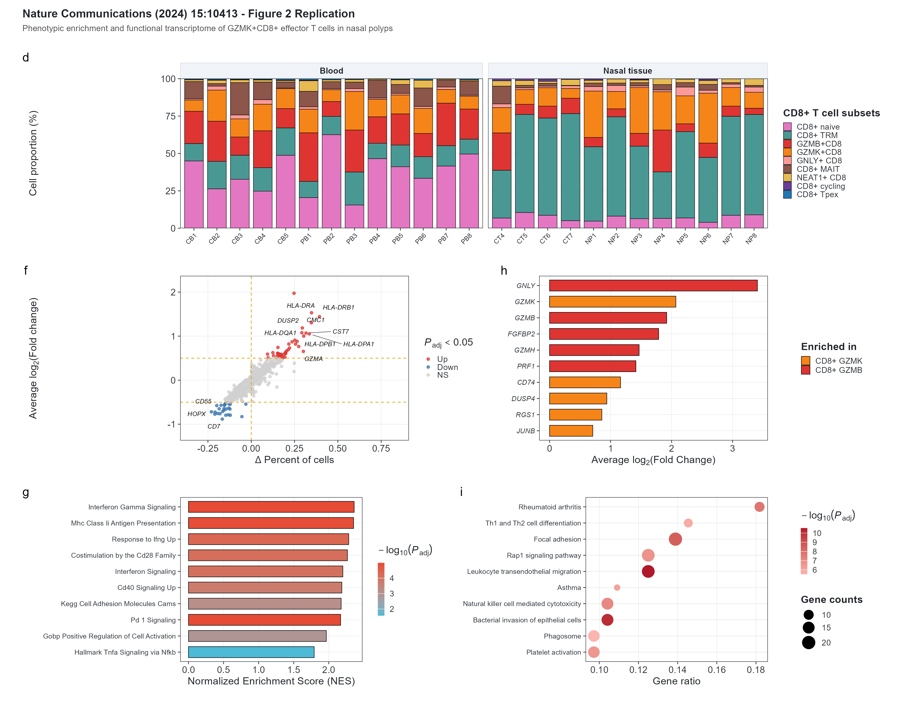
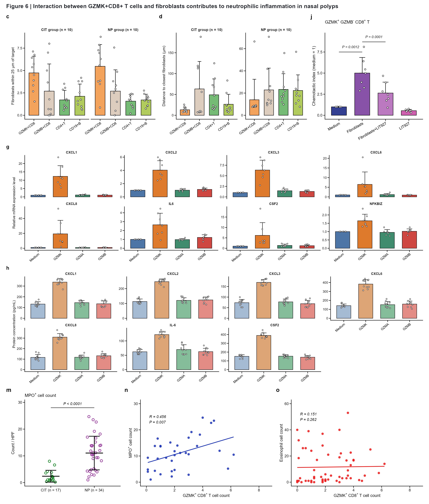

# Replicating Multi-Modal Omics: Nature Communications Case Study

This case study demonstrates the replication of all publication figures from *Nature Communications* (2024) 15:10413 ([PMC11607458](https://pmc.ncbi.nlm.nih.gov/articles/PMC11607458/)): *"Granzyme K⁺CD8⁺ T cells interact with fibroblasts to promote neutrophilic inflammation in nasal polyps"*.

Using real Source Data from `41467_2024_54685_MOESM4_ESM.xlsx`, we implement the figures across clinical flow cytometry (95 donors), single-cell RNA-seq (208,757 cells), Visium HD spatial transcriptomics, in vitro functional assays, and a cross-tissue inflammatory atlas (159 donors across 10 chronic diseases including Skin Atopic Dermatitis).

---

## 1. Study Architecture and Multi-Modal Datasets

The study investigates how non-cytotoxic Granzyme K⁺ (`GZMK⁺`) CD8⁺ T cells drive neutrophilic pathology rather than classic Type 2 eosinophilic inflammation in chronic rhinosinusitis with nasal polyps (CRSwNP):

1. **Clinical Discovery Cohort (scRNA-seq)**: 25 samples recovered from 5 control blood (`CBL`), 8 patient blood (`NP-BL`), 4 control inferior turbinate (`CIT`), and 8 nasal polyp (`NP`) tissues.
2. **Clinical Validation Cohort (Flow Cytometry)**: 95 independent donors (`CBL` $n=22$, `NP-BL` $n=27$, `CIT` $n=14$, `NP` $n=30$).
3. **High-Definition Spatial Transcriptomics (Visium HD)**: 10 clinical specimens (`CIT` $n=4$, `NP` $n=6$) profiling 19 cell lineages at 2 μm resolution.
4. **Spatial Cell-Cell Distance Analysis**: HALO spatial neighborhood counts (< 25 μm) and physical Euclidean distances between T/B cells and `COL1A1⁺` fibroblasts.
5. **Functional In Vitro Assays**: Nasal polyp-derived primary fibroblasts (`NPDF`) stimulated with recombinant `GZMK`, `GZMA`, `GZMB`, and `LIT-927` CXCR4/CXCL12 neutraligand.
6. **Cross-Disease Pan-Tissue Validation**: Integration of 108,969 CD8⁺ T cells across 9 public datasets (159 donors) spanning Atopic Dermatitis (`AD`), Prurigo Nodularis (`PN`), Eosinophilic Esophagitis (`EoE`), Asthma, COPD, Lupus Erythematosus (`DLE`/`SLE`), Thyroiditis, Sepsis, and Hepatitis B (`HBV`).

---

## 2. Figure 2: Single-Cell Phenotype and Transcriptional Signature

Figure 2 resolves 81,202 CD8⁺ T cells into 9 subclusters, identifying a preferential expansion of `GZMK⁺CD8⁺` T cells in nasal polyp tissue with a non-cytotoxic inflammatory signature.

{width=100%}

### Grammar & Assembly Highlights
- **Panel 2d**: 100% stacked bar chart displaying the 9 canonical CD8⁺ subsets across compartments (Blood vs Nasal tissue).
- **Panel 2f**: Single-cell differential expression scatter plot ($\Delta\text{ Percent of cells}$ vs $\text{Average }\log_2(\text{Fold Change})$), with upregulated genes in red (`#DE3533`), downregulated in blue (`#3B75AF`), and non-significant in grey (`#D0D0D0`).
- **Panel 2h**: Horizontal bar plot ranking the top 10 differentially expressed genes between `GZMK⁺` and `GZMB⁺` CD8⁺ T cells, showing elevated *GZMK*, *CD74*, *DUSP4*, *RGS1*, and *JUNB*.
- **Panel 2g & 2i**: Reactome GSEA normalized enrichment scores and KEGG immunological disease pathway dotplots.

---

## 3. Figure 3: Clinical Flow Cytometry Validation (95 Donors)

To validate single-cell transcriptomic predictions, 95 clinical donors were analyzed by multi-parameter flow cytometry and functional cytotoxicity assays.

{width=100%}

### Statistical Observations
- `GZMK⁺GZMB⁻` CD8⁺ T cells are selectively enriched in nasal polyps (`NP`, median 22.4%) compared to control tissue (`CIT`, median 4.5%, $P < 0.0001$).
- Paired MFI demonstrates marked upregulation of the homing receptor *CXCR4* ($P = 0.0371$) and exhaustion marker *PD-1* ($P = 0.0031$) in `GZMK⁺` compared to `GZMB⁺` subsets from the same donors.
- Target cell lysis confirmed that `GZMK⁺` cells possess reduced cytotoxicity ($P = 0.0063$), functioning primarily as cytokine/chemokine producers.

---

## 4. Figure 4 & 5: Visium HD Spatial Deconvolution

Visium HD resolves single-cell neighborhoods across 10 intact clinical tissue sections.

{width=100%}

### Key Visual Elements
- **Panel 5f**: 100% stacked bar chart of all 19 cell lineages across 4 control inferior turbinates (`HD_CIT1`–`4`) and 6 polyps (`HD_NP1`–`6`).
- **Panel 5g**: Ranked cell abundance across all spatial spots.
- **Panel 5h**: Direct frequency comparison of `CD8T_GZMK` ($P = 0.0667$) versus `CD8T_GZMB` ($\text{ns}$) in total CD8⁺ T cells.
- **Panel 5i & 5j**: Proportions of infiltrating B cells ($P = 0.0381$), CD4⁺ T cells ($P = 0.0190$), and smooth muscle cells (SMCs, $P = 0.0095$).

---

## 5. Figure 6: Spatial Neighborhood and Fibroblast Activation Assays

Figure 6 demonstrates the central biological discovery: `GZMK⁺CD8⁺` T cells physically co-localize with fibroblasts (< 25 μm) and trigger high-level secretion of neutrophil-recruiting chemokines (*CXCL1*, *CXCL2*, *CXCL6*, *CXCL8*).

{width=100%}

### Highlights & Quantitative Endpoints
- **Spatial Proximity (c & d)**: Average number of `COL1A1⁺` fibroblasts within 25 μm is highest around `GZMK⁺CD8⁺` T cells in NP tissue ($P = 0.0004$ vs CD4⁺ T, $P = 0.0030$ vs CD19⁺ B).
- **qPCR (g) & Secretome (h)**: Stimulation of primary fibroblasts (`NPDF`, $n=10$) with `GZMK` drives a 10- to 25-fold induction of neutrophil chemokines (*CXCL1*, *CXCL2*, *CXCL6*, *CXCL8*) exceeding `GZMA` and `GZMB` controls ($P < 0.001$).
- **Chemotaxis (j)**: Transwell migration of `GZMK⁺CD8⁺` T cells towards fibroblasts is abrogated by the CXCR4 neutraligand `LIT-927` ($P = 0.0001$).
- **Neutrophil Infiltration (m, n, o)**: MPO⁺ neutrophils are elevated in NP tissue ($P < 0.0001$) and correlate positively with `GZMK⁺CD8⁺` T cell density ($R = 0.456, P = 0.007$), whereas eosinophil infiltration does not correlate ($R = 0.151, P = 0.262$).

---

## 6. Figure 7: Single-Cell TCR Repertoire Diversity and Clonal Expansion

T cell receptor (TCR) sequencing of 25 donors tracks clonal development and transition states.

{width=95%}

- **Panel 7b**: Boxplots of Shannon diversity across `CBL`, `NP-BL`, `CIT`, and `NP` with Dunn's multiple comparison brackets ($P = 0.0381, P = 0.0356$).
- **Panel 7c**: Clonal expansion hierarchy from singletons (clone size = 1, light grey `#D9D9D9`) to hyper-expanded clones (> 50, dark navy `#084594`).

---

## 7. Figure 8: Pan-Tissue Cross-Condition Atlas (10 Diseases, 159 Donors)

To test whether the `GZMK⁺CD8⁺` T cell-fibroblast interaction represents a general mechanism of chronic tissue inflammation, the authors integrated 108,969 CD8⁺ T cells from 9 public scRNA-seq datasets across 10 disease conditions.

{width=100%}

### Skin Atopic Dermatitis Focus
In lesional skin from patients with Atopic Dermatitis (`AD`, GSE197023) and Prurigo Nodularis (`PN`), `GZMK⁺CD8⁺` T cells outnumber `GZMB⁺CD8⁺` T cells:

{width=55%}

- Skin AD: `GZMK⁺CD8⁺` percentage is elevated compared to `GZMB⁺CD8⁺` cells ($P = 0.012$).
- Skin PN: Elevated `GZMK⁺CD8⁺` proportion ($P = 0.0022$).
- Spatial transcriptomics in AD lesional sections confirmed positive neighborhood enrichment between `GZMK⁺CD8⁺` T cells and fibroblasts, driven by the *CXCL12*–*CXCR4* signaling axis.

---

## 8. Summary of Replicated Assets

All 37 figure files and underlying R scripts are available in the `cliomicplot` package under [`inst/examples/nature_communications/`](https://github.com/vanhungtran/cliomicplot/tree/master/inst/examples/nature_communications):

- `generate_nature_commun_figures.R`: Figures 1e, 2d, 2f, 2g, 2i, 5h, 7b, 7c.
- `assemble_composites.R`: Figure 2 Composite (d, f, h, g, i) and Figure 7 Composite (b, c).
- `generate_figure3_figures.R`: Figures 3g, 3j, 3l, 3n, and Figure 3 Composite.
- `generate_figure4_5_figures.R`: Figures 4b, 5f, 5g, 5h, 5i, 5j, and Figure 5 Complete Composite.
- `generate_figure6_figures.R`: Figures 6c, 6d, 6g, 6h, 6i, 6j, 6m, 6n, 6o, and Figure 6 Complete Composite.
- `generate_figure8_figures.R`: Figure 8e (Skin AD & 10-tissue chronic disease atlas).
- `generate_supp_figures.R`: Supplementary Figures S2c, S3c, S12c.
