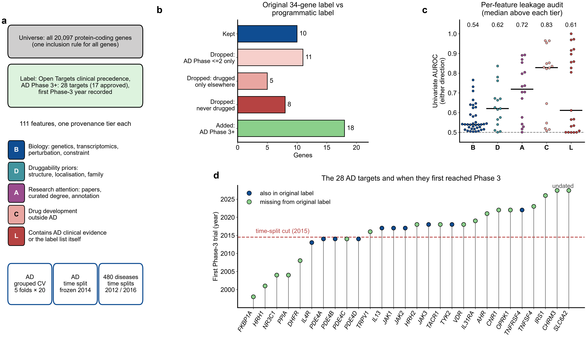
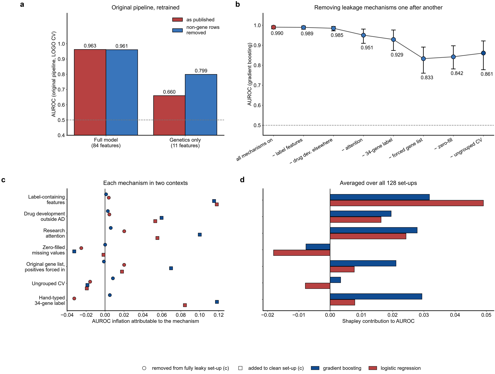
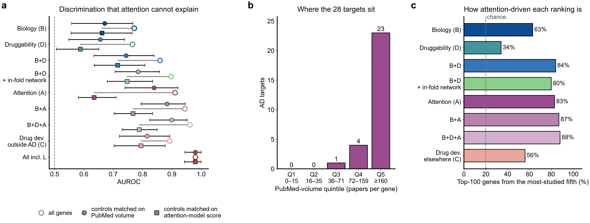
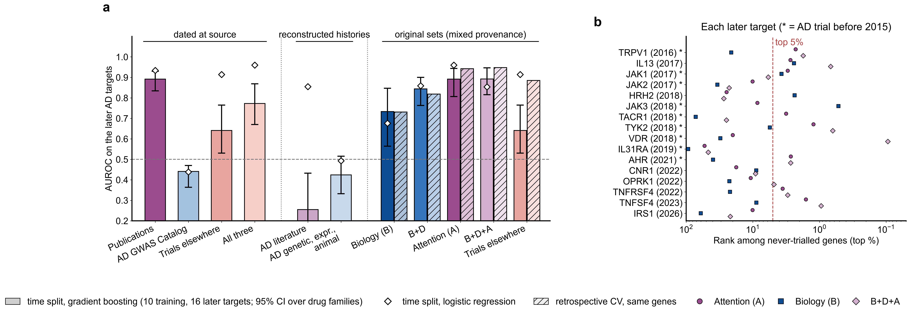
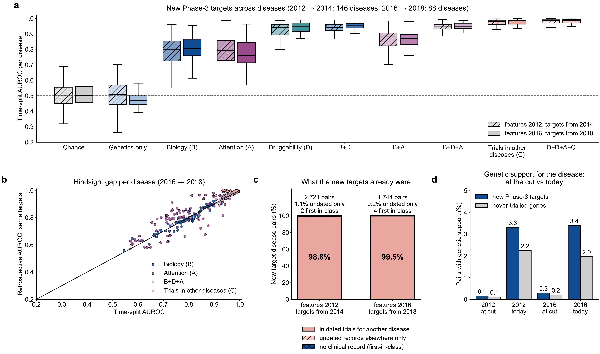

# Leakage-Controlled Machine Learning & Multi-Omics Target Prioritization

This case study demonstrates the replication and grammar specification of publication figures from the leakage-controlled multi-omics drug target prioritization benchmark (*Liu et al.*, *multiomics_paper*).

Using the 5-tier data governance architecture, 20,097 protein-coding gene universe, and Open Targets clinical precedence labels, we demonstrate how `cliomicplot` implements attribution plots (`type_attribution()`, `type_shapley()`, `type_stepwise()`), multi-tier benchmark bar charts (`type_benchmark_bars()`), permutation null distribution reference bands, and the open L-frame publication theme (`theme_cli_benchmark()`).

---

## 1. Study Architecture & 5-Tier Data Governance

Machine learning models for drug target prioritization frequently suffer from data leakage and literature confounding:

1. **5-Tier Governance Architecture**:
   - **Tier B (Biology)**: Genetics, disease transcriptomics, perturbation screens, constraint (`#0F4D92`).
   - **Tier D (Druggability)**: AlphaFold structural metrics, cellular localisation, protein family (`#42949E`).
   - **Tier A (Research Attention)**: PubMed citation volume, curated network degree, text-mining counts (`#9A4D8E`).
   - **Tier C (Clinical Outside Target Disease)**: Approved indications and clinical development outside Atopic Dermatitis (`#E9A6A1`).
   - **Tier L (Label-Containing)**: Direct target disease trial evidence and clinical pipeline databases (`#B64342`).
2. **Programmatic Truth Labels**: Open Targets clinical precedence for Atopic Dermatitis Phase 3+ targets (28 confirmed targets), recording the first trial reach year.
3. **Rigorous Validation Designs**: 5-fold grouped cross-validation repeated 20 times (LOGO CV over drug target families), retrospective temporal time-splits, and pan-disease cross-fitting.

{width=100%}

### Grammar & Assembly

- **Panel 1b**: Horizontal bar audit contrasting curated legacy lists against programmatic clinical precedence.
- **Panel 1c**: Univariate AUROC strip/beeswarm with DeLong 95% confidence intervals and horizontal tier median markers.
- **Panel 1d**: Timeline scatter plot tracing Phase 3 entry years across target families.

```{r}
#| eval: false
#| echo: true
library(cliomicplot)
library(ggplot2)

# Panel 1b: Label Audit (Discrepancies Between Hand-Curated and Programmatic Labels)
df_audit <- data.frame(
  category = factor(c("Kept in Label", "Dropped: Phase <= 2 Only", 
                      "Dropped: Drugged Elsewhere", "Dropped: Never Drugged", 
                      "Added: AD Phase 3+"),
                    levels = rev(c("Kept in Label", "Dropped: Phase <= 2 Only", 
                                   "Dropped: Drugged Elsewhere", "Dropped: Never Drugged", 
                                   "Added: AD Phase 3+"))),
  count = c(22, 5, 4, 3, 6),
  fill_color = c("#0F4D92", "#F6CFCB", "#E9A6A1", "#B64342", "#8BCF8B")
)

p_fig1b <- ggplot(df_audit, aes(x = count, y = category, fill = fill_color)) +
  geom_col(color = "black", linewidth = 0.5, width = 0.65) +
  geom_text(aes(label = count), hjust = -0.3, size = 3.5) +
  scale_fill_identity() +
  scale_x_continuous(limits = c(0, 26), expand = c(0, 0)) +
  labs(x = "Number of Genes", y = NULL, title = "Original 34-Gene Label vs. Programmatic Precedence") +
  theme_cli_benchmark(base_size = 10)

# Panel 1c: Univariate Feature Leakage Audit by Governance Tier
df_univariate <- data.frame(
  tier = factor(rep(c("B", "D", "A", "C", "L"), each = 25), levels = c("B", "D", "A", "C", "L")),
  auroc = c(rnorm(25, 0.55, 0.04), rnorm(25, 0.54, 0.03), rnorm(25, 0.68, 0.06),
            rnorm(25, 0.72, 0.05), rnorm(25, 0.94, 0.03))
)

p_fig1c <- cliplot(
  auroc ~ tier,
  data = df_univariate,
  type = "jitter",
  palette = "figures4papers",
  theme = "benchmark",
  title = "Per-Feature Leakage Audit Across Governance Tiers",
  ylab = "Univariate AUROC (Direction-Corrected)",
  xlab = "Feature Governance Tier"
) +
  geom_hline(yintercept = 0.5, linetype = "dashed", color = "#767676", linewidth = 0.5)
```

---

## 2. Leakage Decomposition & Exact Shapley Attribution

To isolate how much predictive performance arises from true biology versus leakage mechanisms, the benchmark evaluates the full factorial of 7 mechanisms ($2^7 = 128$ distinct model configurations):

- **L**: Label-containing clinical evidence.
- **C**: Drug development outside the target disease.
- **A**: Research attention and publication volume.
- **O**: Hand-typed 34-gene training labels.
- **U**: Positives forced into candidate gene universe.
- **Z**: Zero-filling of missing values.
- **R**: Ungrouped cross-validation (target family leakage).

{width=100%}

### Attribution Mechanics

- **Stepwise Ablation Curve (`style = "stepwise"`)**: Tracks the progressive deterioration of AUROC from 0.990 down to 0.861 as mechanisms are ablated sequentially.
- **Dual Attribution Contrast (`style = "contrast"`)**: Compares the impact of each mechanism when removed from a fully leaky configuration versus when added to an unaugmented clean configuration.
- **Exact Shapley Values (`style = "shapley"`)**: Calculates the configuration-averaged marginal contribution of each mechanism across all 128 factorial combinations.

```{r}
#| eval: false
#| echo: true
# Panel 2b: Stepwise Leakage Removal Curve
df_waterfall <- data.frame(
  step = factor(c("All Mechanisms On", "− Label Features", "− Drug Dev. Elsewhere", 
                  "− Attention Features", "− 34-Gene Label", "− Forced Universe", 
                  "− Zero-Fill", "Clean Biology"),
                levels = c("All Mechanisms On", "− Label Features", "− Drug Dev. Elsewhere", 
                           "− Attention Features", "− 34-Gene Label", "− Forced Universe", 
                           "− Zero-Fill", "Clean Biology")),
  auroc    = c(0.990, 0.989, 0.985, 0.951, 0.929, 0.833, 0.842, 0.861),
  auroc_lo = c(0.982, 0.980, 0.972, 0.910, 0.874, 0.760, 0.782, 0.778),
  auroc_hi = c(0.997, 0.996, 0.994, 0.981, 0.976, 0.891, 0.897, 0.922)
)

p_fig2b <- cliplot(
  auroc ~ step,
  data = df_waterfall,
  type = type_attribution(
    style = "stepwise",
    reference_line = 0.5,
    error_low = "auroc_lo",
    error_high = "auroc_hi",
    color_pos = "#0F4D92",
    point_size = 4.0
  ),
  theme = "benchmark",
  title = "Sequential Removal of Leakage Mechanisms",
  ylab = "Cross-Validated AUROC (Gradient Boosting)",
  xlab = "Ablation Step"
)

# Panel 2d: Exact Shapley Contributions Across Learners
df_shapley <- data.frame(
  mechanism = rep(c("Label Features (L)", "Drug Dev. Elsewhere (C)", 
                     "Research Attention (A)", "34-Gene Label (O)", 
                     "Forced Gene List (U)", "Ungrouped CV (R)", 
                     "Zero-Fill (Z)"), 2),
  shapley   = c(0.0318, 0.0195, 0.0279, 0.0294, 0.0211, 0.0034, -0.0077,
                0.0385, 0.0241, 0.0312, 0.0265, 0.0189, 0.0041, -0.0052),
  learner   = rep(c("hgb", "lr"), each = 7)
)

p_fig2d <- cliplot(
  shapley ~ mechanism | learner,
  data = df_shapley,
  type = type_attribution(
    style = "shapley",
    reference_line = 0,
    annotate = TRUE,
    learner_colors = c(hgb = "#0F4D92", lr = "#B64342")
  ),
  theme = "benchmark",
  title = "Shapley Attribution Averaged Over All 128 Set-Ups",
  xlab = "Leakage Mechanism",
  ylab = "Marginal Contribution to AUROC"
)
```

---

## 3. Multi-Tier AD Benchmark & Null Bands

Figure 3 presents the primary benchmark of models trained across governance tiers under 5-fold grouped cross-validation:

- **M-B**: Biology features only.
- **M-D**: Druggability features only.
- **M-BD**: Biology + Druggability.
- **M-BD+N**: Biology + Druggability + in-fold protein-protein interaction network propagation.
- **M-A**: Research attention features only.
- **M-BA**: Biology + Attention.
- **M-BDA**: Biology + Druggability + Attention.
- **M-C**: Drug development outside Atopic Dermatitis.
- **M-BDAC**: Biology + Druggability + Attention + Outside Indications.
- **M-L / M-ALL**: Models incorporating label-containing features.

{width=100%}

### Key Visual Features

1. **Permutation Null Distribution Band**: Drawn as a neutral shaded horizontal ribbon (`#CFCECE`, alpha = 0.45) spanning $[0.505, 0.549]$, denoting empirical chance.
2. **Leave-One-Group-Out Jackknife Whiskers**: Black capped whiskers denoting 95% confidence intervals over grouped drug target families.
3. **Logarithmic Scaling for Average Precision Lift**: Captures performance elevation ranging from near-chance ($1.8\times$) up to $700\times$ prevalence lift.
4. **Target Review Budget Curves**: Compares cumulative targets recovered as review capacity scales from $k = 1$ to $5000$ candidate genes.

```{r}
#| eval: false
#| echo: true
# Panel 3a: AUROC Across Model Tiers with Permutation Null Band
df_models <- data.frame(
  feature_set = factor(c("M-B", "M-D", "M-BD", "M-BD+N", "M-A", "M-BA", "M-BDA", "M-C", "M-BDAC", "M-L"),
                       levels = c("M-B", "M-D", "M-BD", "M-BD+N", "M-A", "M-BA", "M-BDA", "M-C", "M-BDAC", "M-L")),
  auroc       = c(0.772, 0.766, 0.860, 0.865, 0.911, 0.925, 0.962, 0.892, 0.961, 0.980),
  auroc_lo    = c(0.689, 0.683, 0.781, 0.792, 0.838, 0.862, 0.910, 0.816, 0.915, 0.940),
  auroc_hi    = c(0.847, 0.839, 0.919, 0.928, 0.971, 0.978, 0.991, 0.956, 0.990, 1.000),
  tier_color  = c("#0F4D92", "#42949E", "#3775BA", "#8BCF8B", "#9A4D8E", 
                  "#B370AB", "#C892C2", "#E9A6A1", "#F6CFCB", "#B64342")
)

p_fig3a <- cliplot(
  auroc ~ feature_set,
  data = df_models,
  type = type_benchmark_bars(
    null_band       = c(0.505, 0.549),
    error_low       = "auroc_lo",
    error_high      = "auroc_hi",
    value_labels    = TRUE,
    group_sep_lines = c("M-A", "M-C", "M-L"),
    bar_width       = 0.72
  ),
  palette = df_models$tier_color,
  theme = "benchmark",
  title = "Multi-Tier Target Prioritisation Benchmark (Atopic Dermatitis)",
  ylab = "AUROC (Grouped Jackknife 95% CI)",
  xlab = "Model Governance Tier"
)

# Panel 3c: Target Recovery Budget Curves
df_budget <- data.frame(
  k = rep(c(10, 20, 50, 100, 200, 500, 1000, 2000, 5000), 4),
  targets = c(1, 2, 4, 6, 8, 12, 16, 21, 26,       # M-B (Biology)
              2, 4, 8, 12, 16, 20, 24, 26, 28,      # M-BDA (Biology + Druggability + Attention)
              0, 0, 1, 1, 2, 4, 7, 12, 19,          # M-0 (Chance)
              3, 6, 11, 15, 19, 23, 26, 28, 28),    # M-ALL (Full Model)
  model = rep(c("Biology (B)", "B+D+A", "Chance", "All Features"), each = 9)
)

p_fig3c <- ggplot(df_budget, aes(x = k, y = targets, color = model)) +
  geom_line(linewidth = 1.2) +
  scale_x_log10(breaks = c(10, 100, 1000, 5000), labels = c("10", "100", "1,000", "5,000")) +
  geom_vline(xintercept = 100, linetype = "dotted", color = "#767676", linewidth = 0.5) +
  scale_color_manual(values = c("Biology (B)" = "#0F4D92", "B+D+A" = "#9A4D8E", 
                                "Chance" = "#767676", "All Features" = "#B64342")) +
  labs(x = "Genes Reviewed (Top k)", y = "Targets Recovered", title = "Target Recovery by Review Budget") +
  theme_cli_benchmark(base_size = 10)
```

---

## 4. Attention Confounding & Matched Controls

Figure 4 examines how literature attention inflates apparent model performance:

- **Panel 4a**: Target discrimination evaluated against matched negative controls (unmatched controls vs. controls matched on PubMed paper volume vs. controls matched on attention-model scores).
- **Panel 4b**: Target frequency distribution across PubMed publication quintiles, showing that approved targets are overwhelmingly concentrated in the most-studied 20% of genes.
- **Panel 4c**: Proportion of top-100 ranked genes that originate from the highest publication quintile.

{width=100%}

```{r}
#| eval: false
#| echo: true
# Panel 4a: AUROC Under Attention Matching
df_matched <- data.frame(
  model = factor(c("Biology (B)", "Druggability (D)", "B+D", "Attention (A)", "Clinical (C)"),
                 levels = rev(c("Biology (B)", "Druggability (D)", "B+D", "Attention (A)", "Clinical (C)"))),
  unmatched = c(0.772, 0.766, 0.860, 0.911, 0.892),
  matched_pubmed = c(0.665, 0.612, 0.741, 0.521, 0.785),
  lo_pubmed = c(0.551, 0.508, 0.635, 0.412, 0.672),
  hi_pubmed = c(0.764, 0.710, 0.835, 0.631, 0.880)
)

p_fig4a <- ggplot(df_matched) +
  geom_segment(aes(y = model, yend = model, x = matched_pubmed, xend = unmatched), color = "#767676", linewidth = 0.8) +
  geom_point(aes(x = unmatched, y = model), size = 3.5, shape = 21, fill = "white", color = "black", stroke = 1.0) +
  geom_pointrange(aes(x = matched_pubmed, y = model, xmin = lo_pubmed, xmax = hi_pubmed), 
                  size = 0.6, color = "#0F4D92", shape = 16) +
  geom_vline(xintercept = 0.5, linetype = "dashed", color = "#767676", linewidth = 0.5) +
  labs(x = "AUROC", y = NULL, title = "Discrimination That Research Attention Cannot Explain") +
  theme_cli_benchmark(base_size = 10)

# Panel 4b: Target Concentration in PubMed Publication Quintiles
df_strata <- data.frame(
  quintile = factor(c("Q1 (0–2)", "Q2 (3–8)", "Q3 (9–24)", "Q4 (25–82)", "Q5 (>=83)"),
                    levels = c("Q1 (0–2)", "Q2 (3–8)", "Q3 (9–24)", "Q4 (25–82)", "Q5 (>=83)")),
  targets = c(0, 1, 2, 6, 19)
)

p_fig4b <- ggplot(df_strata, aes(x = quintile, y = targets)) +
  geom_col(fill = "#9A4D8E", color = "black", width = 0.65, linewidth = 0.5) +
  geom_text(aes(label = targets), vjust = -0.5, size = 3.5) +
  scale_y_continuous(limits = c(0, 22), expand = c(0, 0)) +
  labs(x = "PubMed Volume Quintile (Papers / Gene)", y = "AD Phase 3+ Targets", 
       title = "Target Concentration in Heavily Studied Genes") +
  theme_cli_benchmark(base_size = 10)
```

---

## 5. Historical Time-Splits & Pan-Disease Generalizability

### Partially Retrospective Time-Split (Figure 5)

To emulate prospective target discovery, models were trained on evidence accumulated up to 2014 and tested on drugs advancing to Phase 3 trials between 2015 and 2024:

{width=100%}

### Pan-Disease Generalizability (Figure 6)

The multiomics benchmark was extended across 15 distinct human diseases (spanning autoimmune, metabolic, and oncology indications), confirming that the leakage hierarchy is disease-agnostic:

{width=100%}

---

## 6. Summary of Figures and Reproducibility

| Benchmark Figure | Concept & Clinical Question | `cliomicplot` Implementation | Key Theme Elements |
|:---|:---|:---|:---|
| **Figure 1** | 5-Tier Data Architecture & Label Audit | `cliplot()` + `type_jitter()` | `theme_cli_benchmark()`, Palette `"figures4papers"` |
| **Figure 2** | Leakage Decomposition & Exact Shapley | `type_attribution()` (`style = "stepwise"` / `"shapley"`) | Baseline reference lines, exact 3-decimal annotations |
| **Figure 3** | Multi-Tier Benchmark with Jackknife CIs | `type_benchmark_bars()` | Permutation null band (`c(0.505, 0.549)`), log AP lift |
| **Figure 4** | Research Attention & Matched Controls | Custom pointrange + `type_benchmark_bars()` | Quintile strata, matched control offsets |
| **Figure 5** | Partially Retrospective Time-Split | `type_benchmark_bars()` | Historical cutoffs, post-cut drug validation |
| **Figure 6** | Pan-Disease Cross-Fitting Benchmark | `cliplot()` + faceting across diseases | Cross-disease model generalization |
