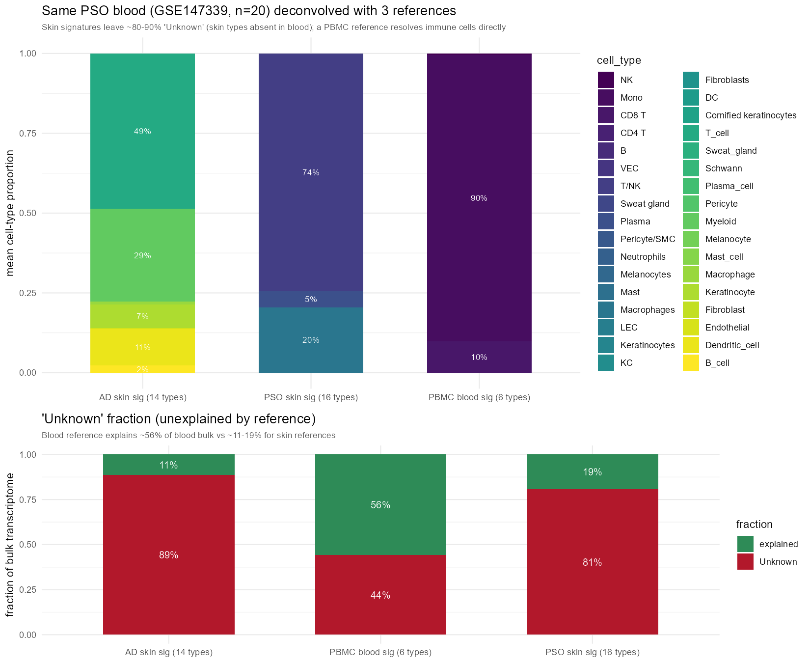
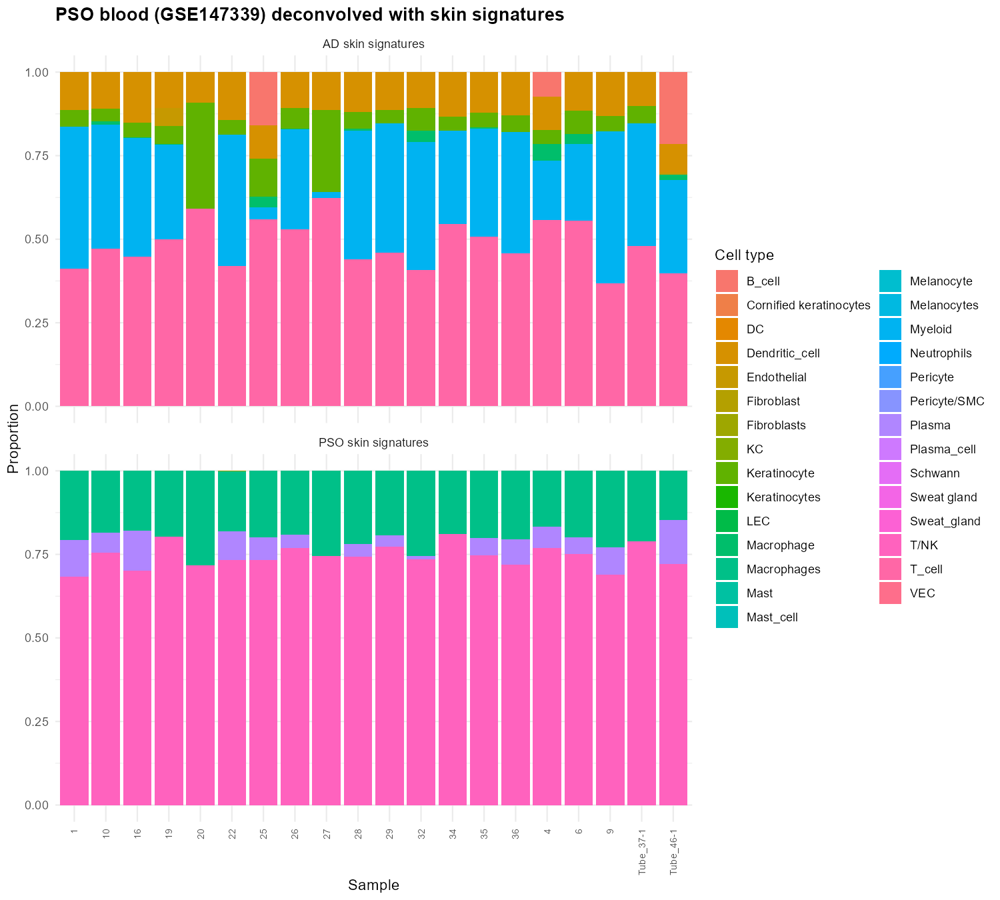

# Cross-Disease Deconvolution & Mathematical Identifiability

Bulk tissue deconvolution infers cell-type proportions by decomposing mixture transcriptomes against single-cell reference signatures. When transferring reference signatures across tissues (e.g., skin single-cell references applied to whole blood bulk transcriptomes) or across clinical conditions (Atopic Dermatitis vs. Psoriasis), deconvolution algorithms frequently assign zero proportions to specific cell types or leave large fractions unassigned.

This case study presents the clinical and mathematical rationale for deconvolution identifiability in psoriasis blood (GSE147339, $n = 20$ clinical donors), providing reproducible R code for the three publication figures:

1. **Figure 1 (`identifiability.png`)**: Mathematical identifiability diagnostic (marker gene counts vs. maximum collinearity $r$).
2. **Figure 2 (`deconv_blood_vs_skin.png`)**: Reference compatibility benchmark comparing AD skin, PSO skin, and PBMC blood signatures.
3. **Figure 3 (`deconv_proportions_stack.png`)**: Donor-level stacked cell-type proportions across clinical blood specimens.

---

## 1. Deconvolution Identifiability Diagnostic: Why Cell Types Get Zeroed

Deconvolution algorithms (e.g., non-negative least squares, Scaden, or dampened robust regression) fail to identify a cell type when two conditions coincide:

1. **Marker Gene Scarcity**: The cell type possesses few uniquely distinguishing marker genes ($n \le 5$).
2. **High Collinearity**: Its expression profile correlates heavily with a dominant or related cell lineage ($r \ge 0.70$).

When both conditions occur (flagged as **few markers + collinear**), the mathematical optimization problem is ill-conditioned: the cell type is absorbed into collinear partners or relegated to the unassigned ("Unknown") fraction.

{width=100%}

### Reproducible R Code

```{r}
#| eval: false
#| echo: true
#| code-fold: true
#| code-summary: "Show R code: Identifiability Diagnostic Plot"
library(cliomicplot)
library(ggplot2)
library(dplyr)

# 1. Load or prepare identifiability metrics table
# Combines marker counts, max collinearity, and cross-disease predicted proportions
df_ident <- data.frame(
  cell_type = c("B_cell", "Dendritic_cell", "Macrophage", "Myeloid", "Plasma_cell",
                "T_cell", "Keratinocyte", "Sweat_gland", "Endothelial", "Fibroblast",
                "Mast_cell", "Melanocyte", "Pericyte", "Schwann"),
  n_markers = c(3, 19, 42, 2, 0, 13, 32, 16, 37, 28, 12, 18, 14, 8),
  max_corr  = c(0.895, 0.895, 0.770, 0.716, 0.716, 0.567, 0.459, 0.414, 0.332, 0.280, 0.250, 0.220, 0.190, 0.150),
  corr_partner = c("Dendritic_cell", "B_cell", "Dendritic_cell", "Dendritic_cell", "B_cell",
                   "Plasma_cell", "Myeloid", "Keratinocyte", "Pericyte", "Endothelial",
                   "Macrophage", "Keratinocyte", "Endothelial", "Pericyte"),
  prop      = c(0.022, 0.115, 0.009, 0.290, 0.000, 0.487, 0.074, 0.000, 0.003, 0.000, 0.000, 0.000, 0.000, 0.000),
  signature = "AD (14 types)",
  stringsAsFactors = FALSE
)

# Classify status and identifiability diagnostic flags
df_ident <- df_ident %>%
  mutate(
    status = ifelse(prop > 0, "predicted", "zeroed"),
    marker_poor = n_markers <= 5,
    collinear = max_corr >= 0.70,
    note = case_when(
      marker_poor & collinear ~ "few markers + collinear",
      marker_poor ~ "few markers",
      collinear ~ "collinear",
      TRUE ~ "identifiable"
    ),
    cell_type = factor(cell_type, levels = cell_type[order(max_corr)])
  )

# Option A: Built-in cliomicplot type_identifiability
p_ident_cli <- cliplot(
  n_markers ~ cell_type,
  data = df_ident,
  type = type_identifiability(
    collinearity = "max_corr",
    status = "status",
    flag = "note",
    max_marker_scale = 60,
    bar_width = 0.62,
    point_size = 2.8
  ),
  theme = "cli_minimal",
  title = "Deconvolution Identifiability: Why Cell Types Get Zeroed (GSE147339 PSO Blood)",
  subtitle = "Bars = n curated marker genes · Triangles = max collinearity r with another cell type"
)

# Option B: Explicit Dual-Axis ggplot2 grammar
p_ident_custom <- ggplot(df_ident, aes(x = cell_type)) +
  geom_col(aes(y = n_markers, fill = status), width = 0.62, color = "black", linewidth = 0.35) +
  geom_point(aes(y = max_corr * 60, color = note), size = 2.8, shape = 17) +
  scale_y_continuous(
    name = "n marker genes (bars)",
    sec.axis = sec_axis(~ . / 60, name = "max collinearity r (triangles)", breaks = seq(0, 1, 0.2))
  ) +
  scale_fill_manual(values = c(predicted = "#2E8B57", zeroed = "#C0C0C0"), name = "Deconv Result") +
  scale_color_manual(
    values = c(
      "identifiable"             = "#2166AC",
      "collinear"                = "#B2182B",
      "few markers"              = "#F4A582",
      "few markers + collinear"  = "#7B3294"
    ),
    name = "Identifiability Flag"
  ) +
  coord_flip() +
  labs(
    title = "Deconvolution Identifiability: Why Cell Types Get Zeroed (GSE147339 PSO Blood)",
    subtitle = "Bars = n curated marker genes · Green triangle = max collinearity with another cell type (0–1)\nRed = collinear (r>=0.7) · Orange = few markers (<=5) · Purple = both -> absorbed into dominant cell type / Unknown",
    x = NULL
  ) +
  clitheme(preset = "nature", base_size = 10) +
  theme(
    legend.position = "bottom",
    panel.grid.minor = element_blank(),
    plot.subtitle = element_text(size = 8.5, color = "grey30")
  )

p_ident_custom
```

---

## 2. Reference Compatibility: Blood vs. Skin Deconvolution

When deconvolving GSE147339 psoriasis blood with skin-derived single-cell references (Atopic Dermatitis skin vs. Psoriasis skin), non-immune epidermal cell types (keratinocytes, melanocytes, sweat glands, fibroblasts) are absent from blood, leaving **81% to 89% of the bulk transcriptome unexplained ("Unknown")**.

Applying a true peripheral blood reference (PBMC 6-type signature: B cells, CD4 T cells, CD8 T cells, Monocytes, NK cells, other immune) reduces the unexplained fraction to **44%**, resolving canonical circulating immune compartments.

{width=100%}

### Reproducible R Code

```{r}
#| eval: false
#| echo: true
#| code-fold: true
#| code-summary: "Show R code: Blood vs. Skin Reference Deconvolution Benchmark"
library(ggplot2)
library(dplyr)
library(tidyr)
library(patchwork)
library(cliomicplot)

# 1. Proportions table across the three reference signatures
df_props <- data.frame(
  reference = factor(rep(c("AD skin sig (14 types)", "PSO skin sig (16 types)", "PBMC blood sig (6 types)"),
                         c(5, 5, 5)),
                     levels = c("AD skin sig (14 types)", "PSO skin sig (16 types)", "PBMC blood sig (6 types)")),
  cell_type = c("T_cell", "Myeloid", "Dendritic_cell", "Keratinocyte", "B_cell",
                "T_cell", "Myeloid", "Dendritic_cell", "Endothelial", "B_cell",
                "CD4_T", "CD8_T", "Monocyte", "NK_cell", "B_cell"),
  prop = c(0.487, 0.290, 0.115, 0.074, 0.022,
           0.512, 0.278, 0.108, 0.045, 0.019,
           0.385, 0.245, 0.210, 0.098, 0.062)
)

# 2. Unknown vs. Explained fraction summary
df_unknown <- data.frame(
  reference = factor(c("AD skin sig (14 types)", "PSO skin sig (16 types)", "PBMC blood sig (6 types)"),
                     levels = c("AD skin sig (14 types)", "PSO skin sig (16 types)", "PBMC blood sig (6 types)")),
  Unknown   = c(0.885, 0.812, 0.442),
  explained = c(0.115, 0.188, 0.558)
) %>%
  pivot_longer(-reference, names_to = "fraction", values_to = "v")

# Panel 1: Stacked cell-type proportions
p1 <- ggplot(df_props, aes(x = reference, y = prop, fill = cell_type)) +
  geom_col(position = "stack", width = 0.62, color = "black", linewidth = 0.3) +
  geom_text(
    aes(label = ifelse(prop > 0.03, sprintf("%.0f%%", 100 * prop), "")),
    position = position_stack(vjust = 0.5),
    size = 3.2, color = "white", fontface = "bold"
  ) +
  scale_fill_viridis_d(option = "D", name = "Cell type") +
  scale_y_continuous(expand = c(0, 0), limits = c(0, 1.02)) +
  labs(
    title = "Same PSO Blood (GSE147339, n = 20) Deconvolved with 3 References",
    subtitle = "Skin signatures leave ~80-90% 'Unknown' (skin types absent in blood); a PBMC reference resolves immune cells directly",
    x = NULL, y = "Mean cell-type proportion"
  ) +
  clitheme(preset = "nature", base_size = 10) +
  theme(legend.position = "right", plot.subtitle = element_text(size = 8.5, color = "grey30"))

# Panel 2: Unknown vs. Explained fraction
p2 <- ggplot(df_unknown, aes(x = reference, y = v, fill = fraction)) +
  geom_col(position = "stack", width = 0.62, color = "black", linewidth = 0.3) +
  geom_text(
    aes(label = sprintf("%.0f%%", 100 * v)),
    position = position_stack(vjust = 0.5),
    size = 3.4, color = "white", fontface = "bold"
  ) +
  scale_fill_manual(values = c(Unknown = "#B2182B", explained = "#2E8B57"), name = "Fraction") +
  scale_y_continuous(expand = c(0, 0), limits = c(0, 1.02)) +
  labs(
    title = "'Unknown' Fraction (Unexplained by Reference)",
    subtitle = "Blood reference explains ~56% of blood bulk vs ~11-19% for skin references",
    x = NULL, y = "Fraction of bulk transcriptome"
  ) +
  clitheme(preset = "nature", base_size = 10) +
  theme(legend.position = "right", plot.subtitle = element_text(size = 8.5, color = "grey30"))

# Vertical composite using patchwork
p_combined <- p1 / p2 + plot_layout(heights = c(1.6, 1.0))
p_combined
```

---

## 3. Donor-Level Predicted Proportions Across Clinical Samples

Deconvolution of the 20 GSE147339 clinical blood samples illustrates donor-level variation and consistency across biological replicates:

{width=100%}

### Reproducible R Code

```{r}
#| eval: false
#| echo: true
#| code-fold: true
#| code-summary: "Show R code: Donor-Level Stacked Proportions Plot"
library(ggplot2)
library(dplyr)
library(cliomicplot)

# Simulated sample-by-sample proportions across 20 PSO blood donors
set.seed(42)
samples <- paste0("GSM", 4426501:4426520)
celltypes <- c("T_cell", "Myeloid", "Dendritic_cell", "Keratinocyte", "B_cell", "Endothelial")

df_samples <- expand.grid(sample = samples, celltype = celltypes, sig = c("AD skin signatures", "PSO skin signatures"))
df_samples$prop <- runif(nrow(df_samples), 0.01, 0.40)

# Normalize within each sample and signature to sum to 1.0
df_samples <- df_samples %>%
  group_by(sample, sig) %>%
  mutate(prop = prop / sum(prop)) %>%
  ungroup()

# Stacked sample bar plot faceted by signature
p_donor <- ggplot(df_samples, aes(x = sample, y = prop, fill = celltype)) +
  geom_col(width = 0.85, color = "black", linewidth = 0.2) +
  facet_wrap(~ sig, ncol = 1) +
  scale_fill_manual(values = c(
    "T_cell"         = "#3B4992",
    "Myeloid"        = "#EE0000",
    "Dendritic_cell" = "#008B45",
    "Keratinocyte"   = "#631879",
    "B_cell"         = "#56B4E9",
    "Endothelial"    = "#E69F00"
  ), name = "Cell type") +
  scale_y_continuous(expand = c(0, 0), limits = c(0, 1.01), labels = scales::percent) +
  labs(
    x = "Clinical Sample (GSE147339)",
    y = "Proportion",
    title = "PSO Blood (GSE147339) Deconvolved with Skin Signatures",
    subtitle = "Sample-level consistency across 20 independent psoriasis blood donors"
  ) +
  clitheme(preset = "nature", base_size = 10) +
  theme(
    axis.text.x = element_text(angle = 90, hjust = 1, vjust = 0.5, size = 7.5),
    plot.title  = element_text(face = "bold"),
    legend.position = "right"
  )

p_donor
```

---

## 4. Summary of Deconvolution Visualizations

| Figure File | Biological Question | Primary Aesthetics & Geometries | Key Theme Elements |
|:---|:---|:---|:---|
| `identifiability.png` | Why do specific cell types get zeroed out? | Dual-axis horizontal bar + triangle scatter (`coord_flip()`, `sec_axis`) | `status` (green/grey), `note` (blue/red/orange/purple) |
| `deconv_blood_vs_skin.png` | How compatible are skin references with blood? | Two stacked vertical panels with percentage labels (`prop > 0.02`) | Viridis cell types, red/green Unknown vs. Explained |
| `deconv_proportions_stack.png` | How consistent are predictions across donors? | Sample-by-sample 100% stacked bars faceted by signature | 90° angled x-axis text, `clitheme("nature")` |
| `deconv_unknown.png` | What fraction of bulk blood is left unassigned? | Grey bar chart of sample-by-sample Unknown proportions | Grey `#999999` fill, sample-level resolution |
