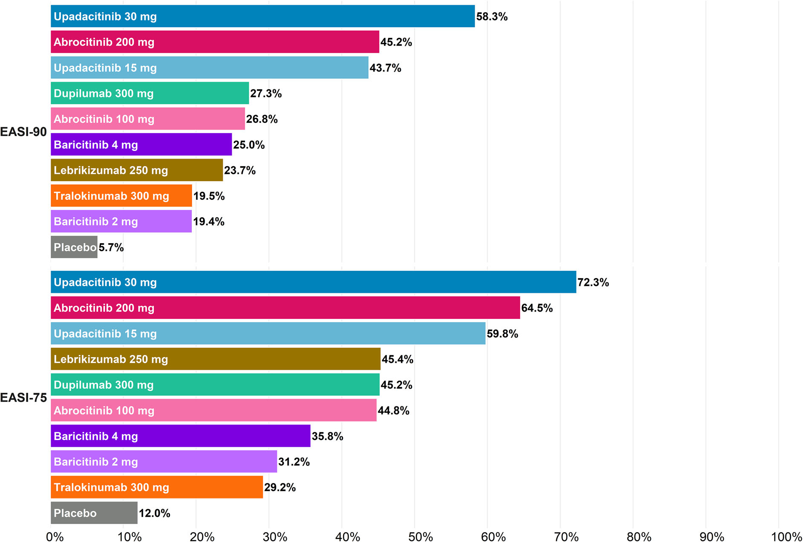
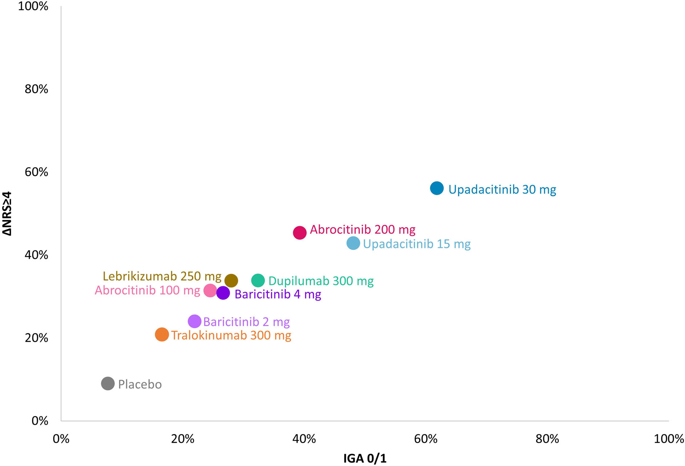

# Bayesian Network Meta-Analysis of Targeted Systemic Therapies

Network meta-analysis (NMA) allows simultaneous comparison of multiple competing interventions by synthesizing both direct within-trial evidence and indirect comparisons across trial networks. In moderate-to-severe atopic dermatitis (AD), numerous targeted systemic therapies have emerged—including oral Janus kinase inhibitors (upadacitinib, abrocitinib, baricitinib) and injectable monoclonal antibodies targeting IL-4/IL-13 signaling (dupilumab, tralokinumab, lebrikizumab).

This case study demonstrates the replication and visual grammar of the landmark Phase 3 network meta-analysis by *Silverberg et al.* (*Dermatol Ther (Heidelb)* 2023, 13:2247–2264, [doi:10.1007/s13555-023-01000-3](https://doi.org/10.1007/s13555-023-01000-3)). Analyzing 13 randomized, double-blind, placebo-controlled monotherapy trials comprising 7,105 adult patients across 32 treatment arms, we replicate the three core figures:

1. **Figure 1**: NMA Evidence Network Diagram connecting all 10 treatment regimens.
2. **Figure 2**: EASI-75 and EASI-90 Bayesian absolute response rate estimates with 95% Credible Intervals (CrI).
3. **Figure 3**: Bivariate IGA 0/1 (clear/almost clear) versus Pruritus $\Delta\text{NRS} \ge 4$ response rate cross-plot.

---

## 1. Study Cohort and Trial Architecture

The network meta-analysis synthesized 13 Phase 3/4 monotherapy trials excluding concomitant topical corticosteroids (TCS) or calcineurin inhibitors (TCI):

- **Oral JAK1 Inhibitors**: Upadacitinib (UPA 30 mg, UPA 15 mg daily; Measure Up 1 & 2), Abrocitinib (ABRO 200 mg, ABRO 100 mg daily; JADE MONO-1 & 2).
- **Oral JAK1/2 Inhibitor**: Baricitinib (BARI 4 mg, BARI 2 mg, BARI 1 mg daily; BREEZE-AD1, BREEZE-AD2, BREEZE-AD5).
- **Dual IL-4R$\alpha$ / IL-13 Antagonist**: Dupilumab (DUPI 300 mg q2w; SOLO 1 & 2).
- **Selective IL-13 Antagonists**: Lebrikizumab (LEBRI 250 mg q2w; ADvocate 1 & 2), Tralokinumab (TRALO 300 mg q2w; ECZTRA 1 & 2).
- **Common Comparator**: Placebo (PBO, $N = 2,501$ patients across all 13 trials).

Core efficacy endpoints evaluated at the primary timepoint (Weeks 12–16) include Eczema Area and Severity Index $\ge 75\%$ improvement (EASI-75), EASI $\ge 90\%$ improvement (EASI-90), Investigator Global Assessment 0/1 with $\ge 2$-point reduction (IGA 0/1), and Pruritus Numerical Rating Scale reduction $\ge 4$ points ($\Delta\text{NRS} \ge 4$).

---

## 2. Figure 1: Evidence Network Topology Diagram

The evidence network forms a star-shaped geometry anchored by the shared placebo control arm ($N = 2,501$), connecting all 10 active regimens across the 13 trials. Node sizes correspond to total patient enrollment per regimen, and connecting edge widths represent the number of randomized trials informing each direct comparison.

{width=100%}

### Reproducible R Code

```{r}
#| eval: false
#| echo: true
#| code-fold: true
#| code-summary: "Show R code: Network Topology Diagram"
library(ggplot2)
library(dplyr)
library(cliomicplot)

# 1. Define nodes (treatments, patient counts, class colors)
nodes_df <- data.frame(
  id = c("Placebo", "UPA_30", "UPA_15", "ABRO_200", "ABRO_100", 
         "BARI_4", "BARI_2", "DUPI_300", "LEBRI_250", "TRALO_300"),
  label = c("Placebo\n(n=2,501)", "Upadacitinib\n30 mg (n=567)", "Upadacitinib\n15 mg (n=557)",
            "Abrocitinib\n200 mg (n=309)", "Abrocitinib\n100 mg (n=314)", "Baricitinib\n4 mg (n=248)",
            "Baricitinib\n2 mg (n=392)", "Dupilumab\n300 mg (n=457)", "Lebrikizumab\n250 mg (n=564)",
            "Tralokinumab\n300 mg (n=1,196)"),
  n = c(2501, 567, 557, 309, 314, 248, 392, 457, 564, 1196),
  class = c("Placebo", "JAK1i", "JAK1i", "JAK1i", "JAK1i", 
            "JAK1/2i", "JAK1/2i", "anti-IL4R", "anti-IL13", "anti-IL13"),
  # Polar coordinates for circular network layout
  angle = c(0, 40, 80, 120, 160, 200, 240, 280, 320, 360) * pi / 180,
  radius = c(0, rep(1.0, 9))
)

nodes_df$x <- nodes_df$radius * cos(nodes_df$angle)
nodes_df$y <- nodes_df$radius * sin(nodes_df$angle)
nodes_df$x[1] <- 0; nodes_df$y[1] <- 0

# 2. Define edges connecting each active therapy to Placebo
edges_df <- data.frame(
  from = rep("Placebo", 9),
  to = c("UPA_30", "UPA_15", "ABRO_200", "ABRO_100", "BARI_4", "BARI_2", "DUPI_300", "LEBRI_250", "TRALO_300"),
  n_trials = c(2, 2, 2, 2, 2, 3, 2, 2, 2)
)

edges_coords <- edges_df %>%
  left_join(nodes_df %>% select(id, x0 = x, y0 = y), by = c("from" = "id")) %>%
  left_join(nodes_df %>% select(id, x1 = x, y1 = y), by = c("to" = "id"))

# 3. Class palette
class_colors <- c(
  "Placebo"   = "#95A5A6",
  "JAK1i"     = "#E74C3C",
  "JAK1/2i"   = "#F39C12",
  "anti-IL4R" = "#1ABC9C",
  "anti-IL13" = "#2980B9"
)

# 4. Render network graph with ggplot2
p_net <- ggplot() +
  geom_segment(
    data = edges_coords,
    aes(x = x0, y = y0, xend = x1, yend = y1, linewidth = n_trials),
    color = "#BDC3C7", alpha = 0.85
  ) +
  geom_point(
    data = nodes_df,
    aes(x = x, y = y, size = n, fill = class),
    shape = 21, color = "black", stroke = 1.0
  ) +
  geom_text(
    data = nodes_df,
    aes(x = x, y = y, label = label),
    size = 2.8, fontface = "bold", vjust = -1.2, lineheight = 0.9
  ) +
  scale_linewidth_continuous(range = c(1.2, 3.5), guide = "none") +
  scale_size_continuous(range = c(6, 18), guide = "none") +
  scale_fill_manual(values = class_colors, name = "Drug Class") +
  scale_x_continuous(limits = c(-1.45, 1.45), expand = c(0, 0)) +
  scale_y_continuous(limits = c(-1.35, 1.45), expand = c(0, 0)) +
  coord_fixed() +
  labs(
    title = "Network Meta-Analysis Diagram: Targeted Systemic Therapies for AD",
    subtitle = "13 Phase 3 randomized monotherapy trials, 7,105 patients across 32 treatment arms"
  ) +
  clitheme(preset = "nature", base_size = 11) +
  theme(
    axis.line = element_blank(),
    axis.text = element_blank(),
    axis.ticks = element_blank(),
    panel.grid = element_blank(),
    legend.position = "bottom"
  )

p_net
```

---

## 2. Figure 2: EASI-75 and EASI-90 Response Rates

Figure 2 presents Bayesian NMA absolute response rate estimates and 95% Credible Intervals (CrI) for EASI-75 and EASI-90 at the primary endpoint (Weeks 12–16):

- **Upadacitinib 30 mg daily** achieved the highest response rates across both thresholds (EASI-75: 72.3% [56.2–84.1%], EASI-90: 58.3% [38.7–75.7%]; SUCRA = 98.5%).
- **Abrocitinib 200 mg daily** ranked second (EASI-75: 64.5% [44.1–81.1%], EASI-90: 45.2% [22.7–71.7%]; SUCRA = 87.3%), followed closely by **Upadacitinib 15 mg daily** (EASI-75: 59.8%, EASI-90: 43.7%; SUCRA = 80.2%).
- Biologics and lower-dose JAK inhibitors occupied the middle tier: **Lebrikizumab 250 mg q2w** (EASI-75: 45.4%, EASI-90: 23.7%), **Dupilumab 300 mg q2w** (EASI-75: 45.2%, EASI-90: 27.3%), and **Abrocitinib 100 mg daily** (EASI-75: 44.8%, EASI-90: 26.8%), followed by Baricitinib and Tralokinumab.

{width=100%}

### Reproducible R Code

```{r}
#| eval: false
#| echo: true
#| code-fold: true
#| code-summary: "Show R code: EASI-75 and EASI-90 Forest Plot"
library(ggplot2)
library(dplyr)
library(cliomicplot)

# 1. Structured NMA estimates from Table 2 of Silverberg et al. (2023)
df_easi <- data.frame(
  treatment = rep(c("Upadacitinib 30 mg", "Abrocitinib 200 mg", "Upadacitinib 15 mg", 
                    "Lebrikizumab 250 mg", "Dupilumab 300 mg", "Abrocitinib 100 mg", 
                    "Baricitinib 4 mg", "Baricitinib 2 mg", "Tralokinumab 300 mg", "Placebo"), 2),
  outcome = rep(c("EASI-75", "EASI-90"), each = 10),
  prop = c(72.3, 64.5, 59.8, 45.4, 45.2, 44.8, 35.8, 31.2, 29.2, 12.0,   # EASI-75
           58.3, 45.2, 43.7, 23.7, 27.3, 26.8, 25.0, 19.4, 19.5, 5.7),    # EASI-90
  lo   = c(56.2, 44.1, 42.4, 28.7, 28.7, 26.1, 20.4, 17.8, 16.8, 6.7,
           38.7, 22.7, 25.9, 12.0, 14.3, 11.4, 11.8, 9.2, 9.4, 2.9),
  hi   = c(84.1, 81.1, 75.0, 63.3, 62.9, 65.8, 54.6, 48.8, 45.9, 20.5,
           75.7, 71.7, 63.4, 41.8, 46.0, 53.2, 45.4, 36.7, 36.6, 10.9),
  class = rep(c("JAK1i", "JAK1i", "JAK1i", "anti-IL13", "anti-IL4R", 
                "JAK1i", "JAK1/2i", "JAK1/2i", "anti-IL13", "Placebo"), 2)
)

# Lock treatment factor levels to match SUCRA hierarchy
treat_levels <- rev(c("Upadacitinib 30 mg", "Abrocitinib 200 mg", "Upadacitinib 15 mg", 
                      "Lebrikizumab 250 mg", "Dupilumab 300 mg", "Abrocitinib 100 mg", 
                      "Baricitinib 4 mg", "Baricitinib 2 mg", "Tralokinumab 300 mg", "Placebo"))
df_easi$treatment <- factor(df_easi$treatment, levels = treat_levels)
df_easi$outcome <- factor(df_easi$outcome, levels = c("EASI-75", "EASI-90"))

# Annotations: exact point estimate and 95% CrI string
df_easi$label_str <- sprintf("%.1f%% (%.1f-%.1f)", df_easi$prop, df_easi$lo, df_easi$hi)

# 2. Render dual-panel forest plot
p_easi <- ggplot(df_easi, aes(x = prop, y = treatment, color = class)) +
  # Alternating row stripes
  geom_rect(
    aes(ymin = as.numeric(treatment) - 0.5, ymax = as.numeric(treatment) + 0.5,
        xmin = -Inf, xmax = Inf,
        fill = as.numeric(treatment) %% 2 == 0),
    inherit.aes = FALSE, alpha = 0.08, show.legend = FALSE
  ) +
  scale_fill_manual(values = c("TRUE" = "grey85", "FALSE" = "white")) +
  geom_errorbarh(aes(xmin = lo, xmax = hi), height = 0.22, linewidth = 0.8) +
  geom_point(size = 3.2, shape = 16) +
  geom_text(aes(x = hi + 2.5, label = label_str), hjust = 0, size = 2.8, color = "black") +
  facet_wrap(~ outcome, scales = "free_x") +
  scale_color_manual(values = c(
    "Placebo"   = "#95A5A6",
    "JAK1i"     = "#E74C3C",
    "JAK1/2i"   = "#F39C12",
    "anti-IL4R" = "#1ABC9C",
    "anti-IL13" = "#2980B9"
  ), name = "Drug Class") +
  scale_x_continuous(limits = c(0, 105), breaks = seq(0, 100, 20), labels = paste0(seq(0, 100, 20), "%")) +
  labs(
    title = "EASI-75 and EASI-90 Absolute Response Rates (Weeks 12-16)",
    subtitle = "Bayesian network meta-analysis medians and 95% Credible Intervals",
    x = "Absolute Response Rate (%)",
    y = NULL
  ) +
  clitheme(preset = "nature", base_size = 11) +
  theme(
    legend.position = "bottom",
    strip.text = element_text(face = "bold", size = 11),
    panel.grid.major.y = element_blank()
  )

p_easi
```

---

## 3. Figure 3: Multi-Domain Efficacy (Skin Clearance vs. Pruritus Relief)

Figure 3 illustrates the bivariate clinical profile across both skin clearance (Investigator Global Assessment 0/1) and rapid pruritus relief ($\Delta\text{NRS} \ge 4$):

- **Upadacitinib 30 mg** demonstrated superior dual-domain efficacy (IGA 0/1: 61.8% [42.3–78.3%]; $\Delta\text{NRS} \ge 4$: 56.1% [39.0–72.0%]).
- **Upadacitinib 15 mg** and **Abrocitinib 200 mg** clustered closely in the high-response quadrant.
- Biologics (**Dupilumab 300 mg**: IGA 32.4%, $\Delta\text{NRS} \ge 4$: 33.9%; **Lebrikizumab 250 mg**: IGA 28.0%, $\Delta\text{NRS} \ge 4$: 34.3%) demonstrated comparable itch and skin response profiles, outpacing Tralokinumab and low-dose Baricitinib.

{width=100%}

### Reproducible R Code

```{r}
#| eval: false
#| echo: true
#| code-fold: true
#| code-summary: "Show R code: Bivariate IGA vs. Pruritus Cross-Plot"
library(ggplot2)
library(ggrepel)
library(cliomicplot)

# 1. Bivariate outcome data from Table 2 of Silverberg et al. (2023)
df_bivariate <- data.frame(
  treatment = c("Upadacitinib 30 mg", "Upadacitinib 15 mg", "Abrocitinib 200 mg",
                "Dupilumab 300 mg", "Lebrikizumab 250 mg", "Baricitinib 4 mg",
                "Abrocitinib 100 mg", "Baricitinib 2 mg", "Tralokinumab 300 mg", "Placebo"),
  iga_prop  = c(61.8, 48.1, 39.3, 32.4, 28.0, 26.7, 24.5, 22.0, 16.6, 7.7),
  iga_lo    = c(42.3, 29.5, 20.5, 17.8, 14.8, 13.1, 11.4, 10.8, 8.3, 4.0),
  iga_hi    = c(78.3, 67.3, 62.6, 51.5, 46.7, 46.8, 46.0, 39.5, 30.7, 14.4),
  nrs_prop  = c(56.1, 42.9, 45.4, 33.9, 34.3, 30.9, 31.5, 24.0, 20.8, 9.0),
  nrs_lo    = c(39.0, 27.3, 27.1, 20.0, 20.0, 16.7, 17.1, 12.8, 11.4, 5.1),
  nrs_hi    = c(72.0, 60.1, 65.4, 51.3, 52.4, 49.9, 51.1, 40.5, 35.0, 15.6),
  class     = c("JAK1i", "JAK1i", "JAK1i", "anti-IL4R", "anti-IL13", 
                "JAK1/2i", "JAK1i", "JAK1/2i", "anti-IL13", "Placebo")
)

# 2. Render bivariate cross-plot with 2D error bars
p_bivariate <- ggplot(df_bivariate, aes(x = iga_prop, y = nrs_prop, color = class)) +
  # Reference crosshairs for placebo baseline
  geom_vline(xintercept = 7.7, linetype = "dashed", color = "#BDC3C7", linewidth = 0.5) +
  geom_hline(yintercept = 9.0, linetype = "dashed", color = "#BDC3C7", linewidth = 0.5) +
  # 2D Credible Interval crossbars
  geom_errorbar(aes(ymin = nrs_lo, ymax = nrs_hi), width = 0.8, alpha = 0.65, linewidth = 0.7) +
  geom_errorbarh(aes(xmin = iga_lo, xmax = iga_hi), height = 0.8, alpha = 0.65, linewidth = 0.7) +
  # Central point estimates
  geom_point(size = 4.0, shape = 16) +
  # Repelled labels
  geom_text_repel(
    aes(label = treatment),
    size = 3.2, fontface = "bold",
    box.padding = 0.45, point.padding = 0.3,
    max.overlaps = 20, show.legend = FALSE
  ) +
  scale_color_manual(values = c(
    "Placebo"   = "#95A5A6",
    "JAK1i"     = "#E74C3C",
    "JAK1/2i"   = "#F39C12",
    "anti-IL4R" = "#1ABC9C",
    "anti-IL13" = "#2980B9"
  ), name = "Drug Class") +
  scale_x_continuous(limits = c(0, 85), breaks = seq(0, 80, 20), labels = paste0(seq(0, 80, 20), "%")) +
  scale_y_continuous(limits = c(0, 80), breaks = seq(0, 80, 20), labels = paste0(seq(0, 80, 20), "%")) +
  labs(
    title = "Multi-Domain Efficacy: Skin Clearance vs. Pruritus Relief",
    subtitle = "IGA 0/1 vs. Pruritus ΔNRS >= 4 absolute response rates with 95% Credible Intervals (Weeks 12-16)",
    x = "Investigator Global Assessment 0/1 Response Rate (%)",
    y = "Pruritus ΔNRS >= 4 Response Rate (%)"
  ) +
  clitheme(preset = "nature", base_size = 11) +
  theme(legend.position = "bottom")

p_bivariate
```

---

## 4. Summary of Network Meta-Analysis Visualizations

| Figure File | Clinical Question | Grammar & Aesthetics | Key Design Elements |
|:---|:---|:---|:---|
| `p9_img0_1885x1483.png` (Fig 1) | What is the structure of randomized evidence? | Polar circular network graph with node size $\propto N$ | Edge thickness $\propto$ trial count, class color coding |
| `p13_img0_1885x1275.jpeg` (Fig 2) | Which regimens maximize EASI-75 and EASI-90? | Dual-panel horizontal forest plot with alternating rows | Medians + 95% CrI whiskers, exact string labels |
| `p14_img0_1885x1282.jpeg` (Fig 3) | How do therapies trade off skin clearance vs. itch relief? | Bivariate scatter cross-plot with 2D error bars | Placebo reference baselines, `geom_text_repel()` |
