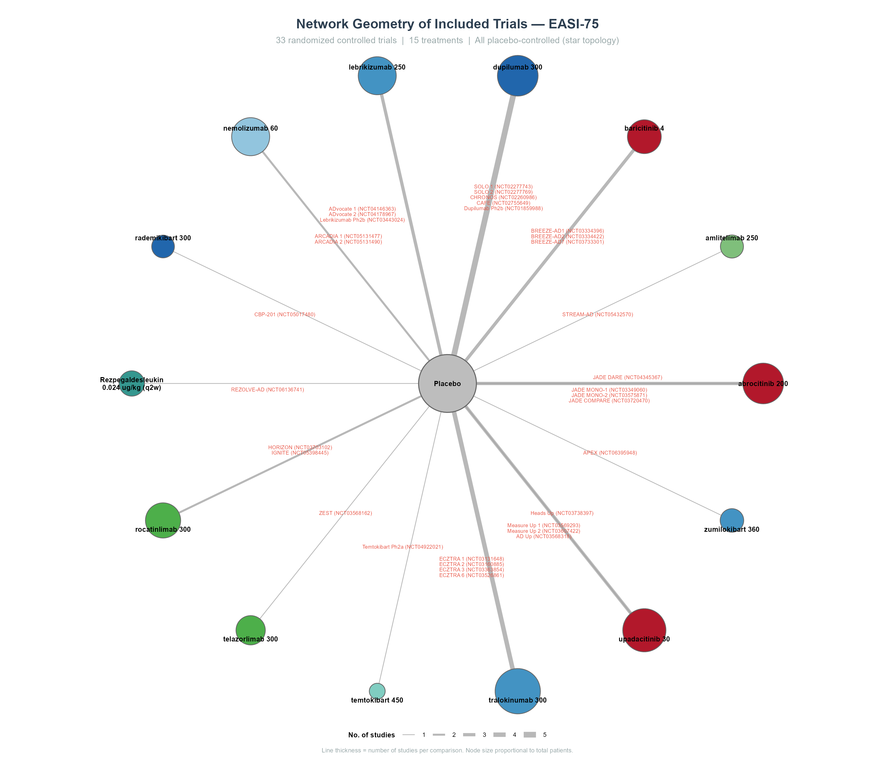
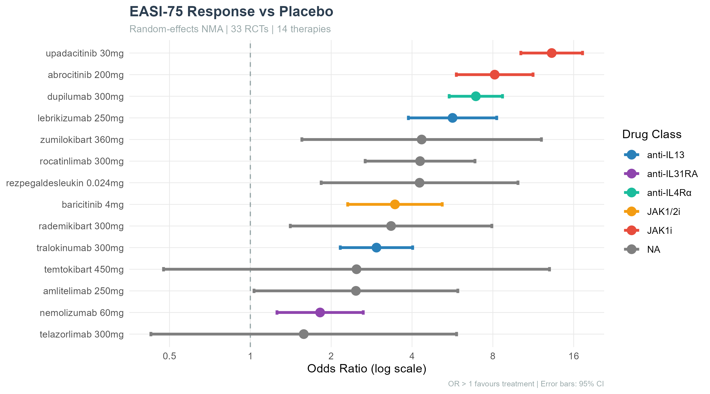
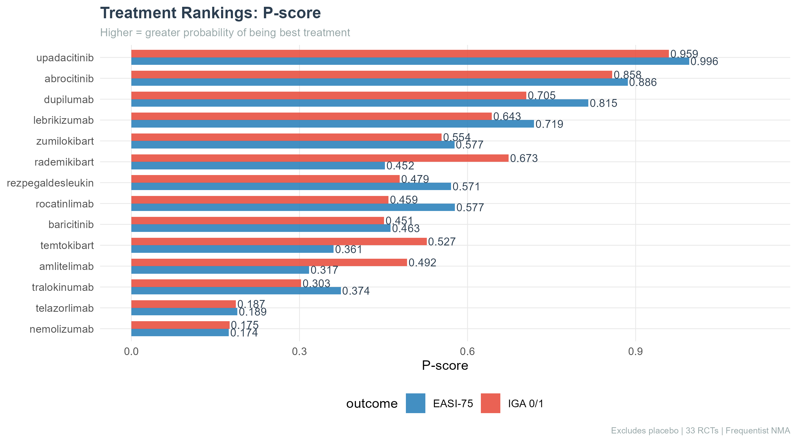
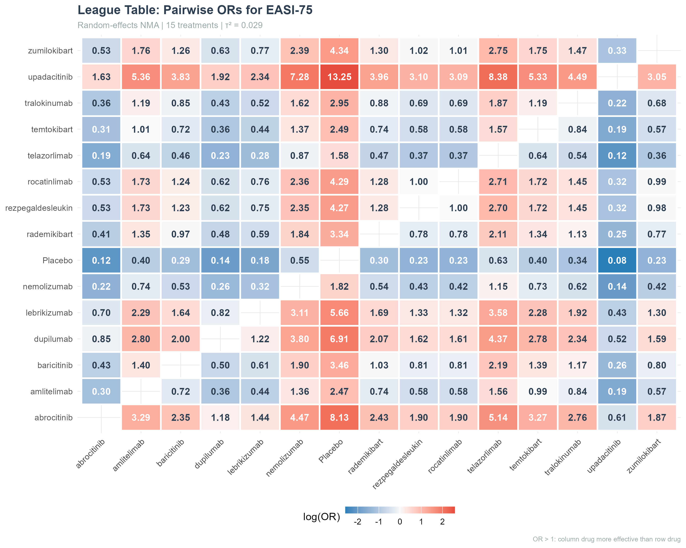
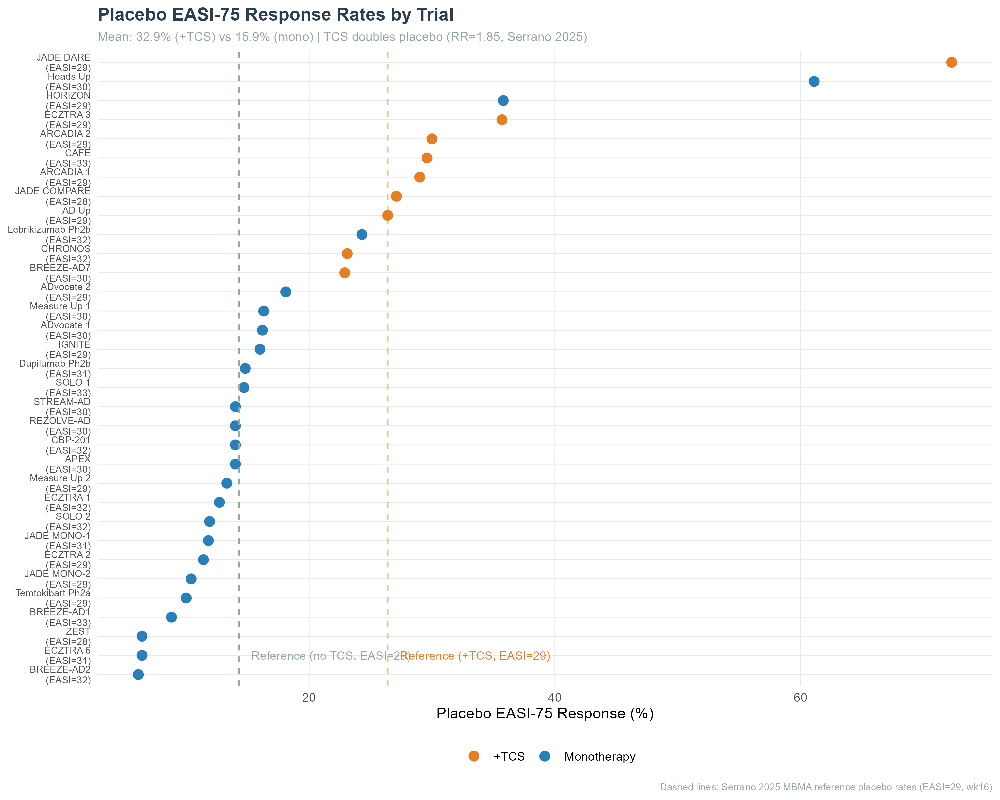
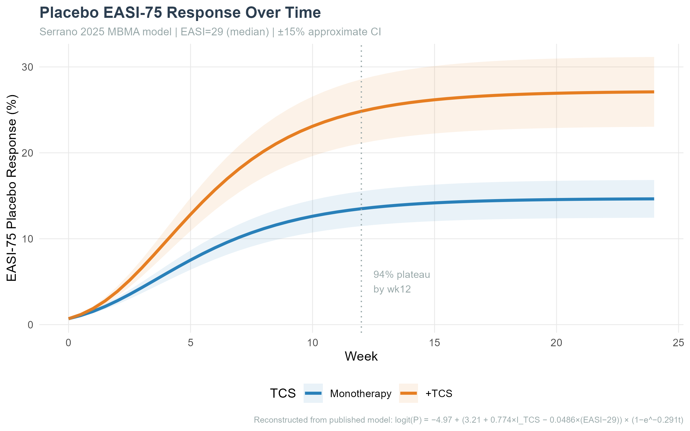
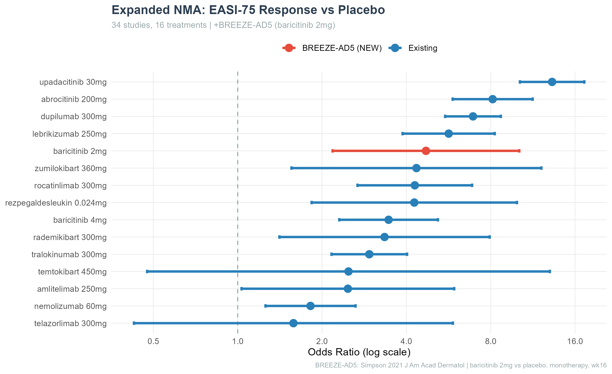
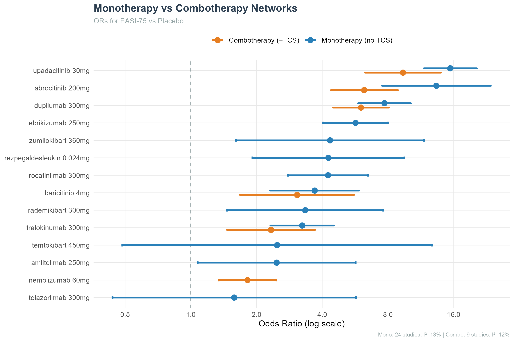
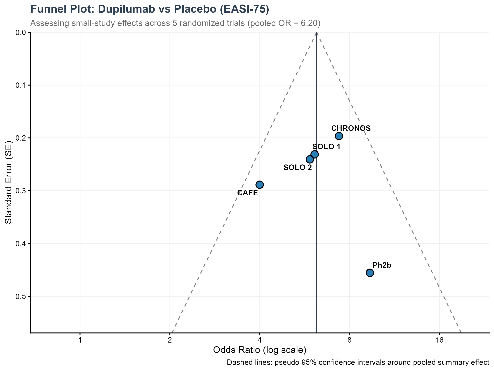

# Bayesian Network Meta-Analysis of Targeted Systemic Therapies

Network meta-analysis (NMA) compares multiple competing interventions simultaneously by synthesizing direct within-trial evidence and indirect comparisons across trial networks. In moderate-to-severe atopic dermatitis (AD), targeted systemic therapies include oral Janus kinase inhibitors (upadacitinib, abrocitinib, baricitinib) and injectable monoclonal antibodies targeting IL-4/IL-13 signaling (dupilumab, tralokinumab, lebrikizumab).

This case study presents the reproducible visual grammar for 12 publication figures across two clinical evidence suites:

1. **Part I: Landmark Phase 3 Monotherapy Bayesian NMA** (*Silverberg et al.*, *Dermatol Ther (Heidelb)* 2023, 13:2247–2264, [doi:10.1007/s13555-023-01000-3](https://doi.org/10.1007/s13555-023-01000-3)). Analyzing 13 randomized, double-blind monotherapy trials comprising 7,105 patients across 32 treatment arms.
2. **Part II: Comparative Effectiveness & Placebo Modeling Suite** (`figures_combined/` suite, incorporating *Babul et al.* 2026 and *Serrano et al.* 2025, *CPT Pharmacometrics Syst Pharmacol*). Analyzing star topologies, head-to-head league matrices, SUCRA/P-score rankings, longitudinal placebo kinetics, and small-study funnel symmetry.

---

# Part I: Landmark Monotherapy Bayesian NMA (Silverberg et al. 2023)

## 1. Study Cohort and Trial Architecture

The monotherapy network synthesized 13 Phase 3/4 trials without concomitant topical corticosteroids (TCS) or calcineurin inhibitors (TCI):

- **Oral JAK1 Inhibitors**: Upadacitinib (UPA 30 mg, UPA 15 mg daily; Measure Up 1 & 2), Abrocitinib (ABRO 200 mg, ABRO 100 mg daily; JADE MONO-1 & 2).
- **Oral JAK1/2 Inhibitor**: Baricitinib (BARI 4 mg, BARI 2 mg daily; BREEZE-AD1, BREEZE-AD2, BREEZE-AD5).
- **Dual IL-4R$\alpha$ / IL-13 Antagonist**: Dupilumab (DUPI 300 mg q2w; SOLO 1 & 2).
- **Selective IL-13 Antagonists**: Lebrikizumab (LEBRI 250 mg q2w; ADvocate 1 & 2), Tralokinumab (TRALO 300 mg q2w; ECZTRA 1 & 2).
- **Common Comparator**: Placebo (PBO, $N = 2,501$ patients across all 13 trials).

Core efficacy endpoints evaluated at Weeks 12–16 include EASI-75, EASI-90, IGA 0/1, and Pruritus $\Delta\text{NRS} \ge 4$.

---

## 2. Figure 1: Evidence Network Topology Diagram

The evidence network forms a star geometry anchored by the shared placebo control arm ($N = 2,501$), connecting 10 active regimens across 13 trials. Node sizes correspond to total patient enrollment, and connecting edge widths represent the number of randomized trials informing each direct comparison.

{width=100%}

### Reproducible R Code

```{r}
#| eval: false
#| echo: true
#| code-fold: true
#| code-summary: "Show R code: Network Topology Diagram"
library(ggplot2)
library(dplyr)
library(cliomicplot)

# 1. Define nodes (treatments, patient counts, class colors)
nodes_df <- data.frame(
  id = c("Placebo", "UPA_30", "UPA_15", "ABRO_200", "ABRO_100", 
         "BARI_4", "BARI_2", "DUPI_300", "LEBRI_250", "TRALO_300"),
  label = c("Placebo\n(n=2,501)", "Upadacitinib\n30 mg (n=567)", "Upadacitinib\n15 mg (n=557)",
            "Abrocitinib\n200 mg (n=309)", "Abrocitinib\n100 mg (n=314)", "Baricitinib\n4 mg (n=248)",
            "Baricitinib\n2 mg (n=392)", "Dupilumab\n300 mg (n=457)", "Lebrikizumab\n250 mg (n=564)",
            "Tralokinumab\n300 mg (n=1,196)"),
  n = c(2501, 567, 557, 309, 314, 248, 392, 457, 564, 1196),
  class = c("Placebo", "JAK1i", "JAK1i", "JAK1i", "JAK1i", 
            "JAK1/2i", "JAK1/2i", "anti-IL4R", "anti-IL13", "anti-IL13"),
  angle = c(0, 40, 80, 120, 160, 200, 240, 280, 320, 360) * pi / 180,
  radius = c(0, rep(1.0, 9))
)

nodes_df$x <- nodes_df$radius * cos(nodes_df$angle)
nodes_df$y <- nodes_df$radius * sin(nodes_df$angle)
nodes_df$x[1] <- 0; nodes_df$y[1] <- 0

# 2. Define edges connecting each active therapy to Placebo
edges_df <- data.frame(
  from = rep("Placebo", 9),
  to = c("UPA_30", "UPA_15", "ABRO_200", "ABRO_100", "BARI_4", "BARI_2", "DUPI_300", "LEBRI_250", "TRALO_300"),
  n_trials = c(2, 2, 2, 2, 2, 3, 2, 2, 2)
)

edges_coords <- edges_df %>%
  left_join(nodes_df %>% select(id, x0 = x, y0 = y), by = c("from" = "id")) %>%
  left_join(nodes_df %>% select(id, x1 = x, y1 = y), by = c("to" = "id"))

# 3. Class palette
class_colors <- c(
  "Placebo"   = "#95A5A6",
  "JAK1i"     = "#E74C3C",
  "JAK1/2i"   = "#F39C12",
  "anti-IL4R" = "#1ABC9C",
  "anti-IL13" = "#2980B9"
)

# 4. Render network graph with ggplot2
p_net <- ggplot() +
  geom_segment(
    data = edges_coords,
    aes(x = x0, y = y0, xend = x1, yend = y1, linewidth = n_trials),
    color = "#BDC3C7", alpha = 0.85
  ) +
  geom_point(
    data = nodes_df,
    aes(x = x, y = y, size = n, fill = class),
    shape = 21, color = "black", stroke = 1.0
  ) +
  geom_text(
    data = nodes_df,
    aes(x = x, y = y, label = label),
    size = 2.8, fontface = "bold", vjust = -1.2, lineheight = 0.9
  ) +
  scale_linewidth_continuous(range = c(1.2, 3.5), guide = "none") +
  scale_size_continuous(range = c(6, 18), guide = "none") +
  scale_fill_manual(values = class_colors, name = "Drug Class") +
  scale_x_continuous(limits = c(-1.45, 1.45), expand = c(0, 0)) +
  scale_y_continuous(limits = c(-1.35, 1.45), expand = c(0, 0)) +
  coord_fixed() +
  labs(
    title = "Network Meta-Analysis Diagram: Targeted Systemic Therapies for AD",
    subtitle = "13 Phase 3 randomized monotherapy trials, 7,105 patients across 32 treatment arms"
  ) +
  clitheme(preset = "nature", base_size = 11) +
  theme(
    axis.line = element_blank(),
    axis.text = element_blank(),
    axis.ticks = element_blank(),
    panel.grid = element_blank(),
    legend.position = "bottom"
  )

p_net
```

---

## 3. Figure 2: EASI-75 and EASI-90 Response Rates

Figure 2 presents Bayesian NMA absolute response rate estimates and 95% Credible Intervals (CrI) for EASI-75 and EASI-90 at Weeks 12–16:

- **Upadacitinib 30 mg daily** achieved the highest response rates across both thresholds (EASI-75: 72.3% [56.2–84.1%], EASI-90: 58.3% [38.7–75.7%]; SUCRA = 98.5%).
- **Abrocitinib 200 mg daily** ranked second (EASI-75: 64.5% [44.1–81.1%], EASI-90: 45.2% [22.7–71.7%]; SUCRA = 87.3%), followed by **Upadacitinib 15 mg daily** (EASI-75: 59.8%, EASI-90: 43.7%; SUCRA = 80.2%).
- Biologics and lower-dose JAK inhibitors occupied the middle tier: **Lebrikizumab 250 mg q2w** (EASI-75: 45.4%, EASI-90: 23.7%), **Dupilumab 300 mg q2w** (EASI-75: 45.2%, EASI-90: 27.3%), and **Abrocitinib 100 mg daily** (EASI-75: 44.8%, EASI-90: 26.8%).

{width=100%}

### Reproducible R Code

```{r}
#| eval: false
#| echo: true
#| code-fold: true
#| code-summary: "Show R code: EASI-75 and EASI-90 Forest Plot"
library(ggplot2)
library(dplyr)
library(cliomicplot)

# 1. Structured NMA estimates from Table 2 of Silverberg et al. (2023)
df_easi <- data.frame(
  treatment = rep(c("Upadacitinib 30 mg", "Abrocitinib 200 mg", "Upadacitinib 15 mg", 
                    "Lebrikizumab 250 mg", "Dupilumab 300 mg", "Abrocitinib 100 mg", 
                    "Baricitinib 4 mg", "Baricitinib 2 mg", "Tralokinumab 300 mg", "Placebo"), 2),
  outcome = rep(c("EASI-75", "EASI-90"), each = 10),
  prop = c(72.3, 64.5, 59.8, 45.4, 45.2, 44.8, 35.8, 31.2, 29.2, 12.0,
           58.3, 45.2, 43.7, 23.7, 27.3, 26.8, 25.0, 19.4, 19.5, 5.7),
  lo   = c(56.2, 44.1, 42.4, 28.7, 28.7, 26.1, 20.4, 17.8, 16.8, 6.7,
           38.7, 22.7, 25.9, 12.0, 14.3, 11.4, 11.8, 9.2, 9.4, 2.9),
  hi   = c(84.1, 81.1, 75.0, 63.3, 62.9, 65.8, 54.6, 48.8, 45.9, 20.5,
           75.7, 71.7, 63.4, 41.8, 46.0, 53.2, 45.4, 36.7, 36.6, 10.9),
  class = rep(c("JAK1i", "JAK1i", "JAK1i", "anti-IL13", "anti-IL4R", 
                "JAK1i", "JAK1/2i", "JAK1/2i", "anti-IL13", "Placebo"), 2)
)

treat_levels <- rev(c("Upadacitinib 30 mg", "Abrocitinib 200 mg", "Upadacitinib 15 mg", 
                      "Lebrikizumab 250 mg", "Dupilumab 300 mg", "Abrocitinib 100 mg", 
                      "Baricitinib 4 mg", "Baricitinib 2 mg", "Tralokinumab 300 mg", "Placebo"))
df_easi$treatment <- factor(df_easi$treatment, levels = treat_levels)
df_easi$outcome <- factor(df_easi$outcome, levels = c("EASI-75", "EASI-90"))
df_easi$label_str <- sprintf("%.1f%% (%.1f-%.1f)", df_easi$prop, df_easi$lo, df_easi$hi)

# 2. Render dual-panel forest plot
p_easi <- ggplot(df_easi, aes(x = prop, y = treatment, color = class)) +
  geom_rect(
    aes(ymin = as.numeric(treatment) - 0.5, ymax = as.numeric(treatment) + 0.5,
        xmin = -Inf, xmax = Inf,
        fill = as.numeric(treatment) %% 2 == 0),
    inherit.aes = FALSE, alpha = 0.08, show.legend = FALSE
  ) +
  scale_fill_manual(values = c("TRUE" = "grey85", "FALSE" = "white")) +
  geom_errorbarh(aes(xmin = lo, xmax = hi), height = 0.22, linewidth = 0.8) +
  geom_point(size = 3.2, shape = 16) +
  geom_text(aes(x = hi + 2.5, label = label_str), hjust = 0, size = 2.8, color = "black") +
  facet_wrap(~ outcome, scales = "free_x") +
  scale_color_manual(values = c(
    "Placebo"   = "#95A5A6",
    "JAK1i"     = "#E74C3C",
    "JAK1/2i"   = "#F39C12",
    "anti-IL4R" = "#1ABC9C",
    "anti-IL13" = "#2980B9"
  ), name = "Drug Class") +
  scale_x_continuous(limits = c(0, 105), breaks = seq(0, 100, 20), labels = paste0(seq(0, 100, 20), "%")) +
  labs(
    title = "EASI-75 and EASI-90 Absolute Response Rates (Weeks 12-16)",
    subtitle = "Bayesian network meta-analysis medians and 95% Credible Intervals",
    x = "Absolute Response Rate (%)",
    y = NULL
  ) +
  clitheme(preset = "nature", base_size = 11) +
  theme(
    legend.position = "bottom",
    strip.text = element_text(face = "bold", size = 11),
    panel.grid.major.y = element_blank()
  )

p_easi
```

---

## 4. Figure 3: Multi-Domain Efficacy (Skin Clearance vs. Pruritus Relief)

Figure 3 maps the bivariate trade-off between skin clearance (IGA 0/1) and rapid pruritus relief ($\Delta\text{NRS} \ge 4$):

- **Upadacitinib 30 mg** demonstrated superior dual-domain efficacy (IGA 0/1: 61.8% [42.3–78.3%]; $\Delta\text{NRS} \ge 4$: 56.1% [39.0–72.0%]).
- **Upadacitinib 15 mg** and **Abrocitinib 200 mg** clustered in the second-highest quadrant.
- Biologics (**Dupilumab 300 mg**: IGA 32.4%, $\Delta\text{NRS} \ge 4$: 33.9%; **Lebrikizumab 250 mg**: IGA 28.0%, $\Delta\text{NRS} \ge 4$: 34.3%) demonstrated balanced itch and skin response profiles.

{width=100%}

### Reproducible R Code

```{r}
#| eval: false
#| echo: true
#| code-fold: true
#| code-summary: "Show R code: Bivariate IGA vs. Pruritus Cross-Plot"
library(ggplot2)
library(ggrepel)
library(cliomicplot)

# 1. Bivariate outcome data from Table 2 of Silverberg et al. (2023)
df_bivariate <- data.frame(
  treatment = c("Upadacitinib 30 mg", "Upadacitinib 15 mg", "Abrocitinib 200 mg",
                "Dupilumab 300 mg", "Lebrikizumab 250 mg", "Baricitinib 4 mg",
                "Abrocitinib 100 mg", "Baricitinib 2 mg", "Tralokinumab 300 mg", "Placebo"),
  iga_prop  = c(61.8, 48.1, 39.3, 32.4, 28.0, 26.7, 24.5, 22.0, 16.6, 7.7),
  iga_lo    = c(42.3, 29.5, 20.5, 17.8, 14.8, 13.1, 11.4, 10.8, 8.3, 4.0),
  iga_hi    = c(78.3, 67.3, 62.6, 51.5, 46.7, 46.8, 46.0, 39.5, 30.7, 14.4),
  nrs_prop  = c(56.1, 42.9, 45.4, 33.9, 34.3, 30.9, 31.5, 24.0, 20.8, 9.0),
  nrs_lo    = c(39.0, 27.3, 27.1, 20.0, 20.0, 16.7, 17.1, 12.8, 11.4, 5.1),
  nrs_hi    = c(72.0, 60.1, 65.4, 51.3, 52.4, 49.9, 51.1, 40.5, 35.0, 15.6),
  class     = c("JAK1i", "JAK1i", "JAK1i", "anti-IL4R", "anti-IL13", 
                "JAK1/2i", "JAK1i", "JAK1/2i", "anti-IL13", "Placebo")
)

# 2. Render bivariate cross-plot with 2D error bars
p_bivariate <- ggplot(df_bivariate, aes(x = iga_prop, y = nrs_prop, color = class)) +
  geom_vline(xintercept = 7.7, linetype = "dashed", color = "#BDC3C7", linewidth = 0.5) +
  geom_hline(yintercept = 9.0, linetype = "dashed", color = "#BDC3C7", linewidth = 0.5) +
  geom_errorbar(aes(ymin = nrs_lo, ymax = nrs_hi), width = 0.8, alpha = 0.65, linewidth = 0.7) +
  geom_errorbarh(aes(xmin = iga_lo, xmax = iga_hi), height = 0.8, alpha = 0.65, linewidth = 0.7) +
  geom_point(size = 4.0, shape = 16) +
  geom_text_repel(
    aes(label = treatment),
    size = 3.2, fontface = "bold",
    box.padding = 0.45, point.padding = 0.3,
    max.overlaps = 20, show.legend = FALSE
  ) +
  scale_color_manual(values = c(
    "Placebo"   = "#95A5A6",
    "JAK1i"     = "#E74C3C",
    "JAK1/2i"   = "#F39C12",
    "anti-IL4R" = "#1ABC9C",
    "anti-IL13" = "#2980B9"
  ), name = "Drug Class") +
  scale_x_continuous(limits = c(0, 85), breaks = seq(0, 80, 20), labels = paste0(seq(0, 80, 20), "%")) +
  scale_y_continuous(limits = c(0, 80), breaks = seq(0, 80, 20), labels = paste0(seq(0, 80, 20), "%")) +
  labs(
    title = "Multi-Domain Efficacy: Skin Clearance vs. Pruritus Relief",
    subtitle = "IGA 0/1 vs. Pruritus ΔNRS >= 4 absolute response rates with 95% Credible Intervals (Weeks 12-16)",
    x = "Investigator Global Assessment 0/1 Response Rate (%)",
    y = "Pruritus ΔNRS >= 4 Response Rate (%)"
  ) +
  clitheme(preset = "nature", base_size = 11) +
  theme(legend.position = "bottom")

p_bivariate
```

---

# Part II: Comparative Effectiveness & Placebo Modeling Suite (`figures_combined/`)

## 5. Figure 4: Network Geometry with Trial and NCT Identifiers

`Fig1_network.png` maps the star network layout centered on Placebo, labeling each radiating edge with trial names and ClinicalTrials.gov NCT identifiers. Line widths reflect the number of direct studies, and node diameters scale with total enrolled sample sizes.

{width=100%}

### Reproducible R Code

```{r}
#| eval: false
#| echo: true
#| code-fold: true
#| code-summary: "Show R code: Network Geometry with Trial Labels"
library(ggplot2)
library(dplyr)
library(ggrepel)

# 1. Edge definitions with study identifiers
edge_counts <- data.frame(
  from = rep("Placebo", 10),
  to = c("upadacitinib 30mg", "upadacitinib 15mg", "abrocitinib 200mg", "abrocitinib 100mg",
         "baricitinib 4mg", "baricitinib 2mg", "dupilumab 300mg", "lebrikizumab 250mg",
         "tralokinumab 300mg", "nemolizumab 30mg"),
  n_studies = c(2, 2, 2, 2, 2, 3, 4, 2, 3, 1),
  trial_labels = c("Measure Up 1/2\n(NCT03569293)", "Measure Up 1/2\n(NCT03607422)",
                   "JADE MONO-1/2\n(NCT03349060)", "JADE MONO-1/2\n(NCT03575871)",
                   "BREEZE-AD1/2\n(NCT03334396)", "BREEZE-AD1/2/5\n(NCT03334435)",
                   "SOLO 1/2, CHRONOS\n(NCT02277743)", "ADvocate 1/2\n(NCT04146363)",
                   "ECZTRA 1/2/3\n(NCT03134781)", "XCIMA\n(NCT01986933)")
)

# 2. Polar node placement
n_drugs <- nrow(edge_counts)
angles <- seq(0, 2 * pi, length.out = n_drugs + 1)[1:n_drugs]
radius <- 3.5

drug_nodes <- data.frame(
  treatment = edge_counts$to,
  label = c("Upadacitinib\n30 mg", "Upadacitinib\n15 mg", "Abrocitinib\n200 mg", "Abrocitinib\n100 mg",
            "Baricitinib\n4 mg", "Baricitinib\n2 mg", "Dupilumab\n300 mg", "Lebrikizumab\n250 mg",
            "Tralokinumab\n300 mg", "Nemolizumab\n30 mg"),
  x = radius * cos(angles),
  y = radius * sin(angles),
  patients = c(567, 557, 309, 314, 248, 392, 1056, 564, 1596, 230),
  color = c("#B2182B", "#B2182B", "#B2182B", "#B2182B", "#F39C12", "#F39C12", "#2166AC", "#4393C3", "#92C5DE", "#8E44AD")
)

placebo_node <- data.frame(
  treatment = "Placebo", label = "Placebo",
  x = 0, y = 0, patients = 2501, color = "#BDBDBD"
)

layout_df <- bind_rows(placebo_node, drug_nodes)

edge_df <- edge_counts %>%
  left_join(layout_df %>% select(treatment, to_x = x, to_y = y), by = c("to" = "treatment")) %>%
  mutate(from_x = 0, from_y = 0)

# 3. Render polar star network
p_fig1 <- ggplot() +
  geom_segment(data = edge_df, aes(x = from_x, y = from_y, xend = to_x, yend = to_y, linewidth = n_studies),
               color = "grey60", alpha = 0.7) +
  geom_point(data = layout_df %>% filter(treatment != "Placebo"),
             aes(x = x, y = y, size = patients, fill = color), shape = 21, color = "grey40", stroke = 0.6) +
  geom_point(data = layout_df %>% filter(treatment == "Placebo"),
             aes(x = x, y = y, size = patients), shape = 21, fill = "#BDBDBD", color = "grey40", stroke = 0.8) +
  geom_text(data = layout_df, aes(x = x, y = y, label = label), size = 2.8, fontface = "bold", lineheight = 0.9,
            vjust = ifelse(layout_df$y > 0.2, -1.2, ifelse(layout_df$y < -0.2, 2.2, 0.5))) +
  geom_text_repel(data = edge_df, aes(x = to_x * 0.55, y = to_y * 0.55, label = trial_labels),
                  size = 2.1, color = "#E74C3C", lineheight = 0.85, max.overlaps = 40) +
  scale_linewidth_continuous(range = c(0.4, 3.0), name = "No. of studies") +
  scale_size_continuous(range = c(8, 26), name = "Total patients", labels = scales::comma) +
  scale_fill_identity() +
  coord_fixed(clip = "off") +
  labs(
    title = "Network Geometry of Included Trials — EASI-75",
    subtitle = "Placebo-controlled star topology with clinical trial registry identifiers",
    caption = "Line thickness = number of studies per comparison. Node size proportional to total patients."
  ) +
  theme_void(base_size = 12) +
  theme(
    plot.title = element_text(face = "bold", size = 14, hjust = 0.5, color = "#2C3E50"),
    plot.subtitle = element_text(size = 10, hjust = 0.5, color = "#95A5A6"),
    plot.caption = element_text(size = 7.5, hjust = 0.5, color = "#95A5A6"),
    legend.position = "bottom"
  )

p_fig1
```

---

## 6. Figure 5: EASI-75 Odds Ratios vs. Placebo

`Fig2_forest.png` displays odds ratios (OR) and 95% confidence intervals on a logarithmic scale from random-effects network meta-analysis. Therapies are ordered by point estimates, with colors distinguishing mechanisms of action.

{width=100%}

### Reproducible R Code

```{r}
#| eval: false
#| echo: true
#| code-fold: true
#| code-summary: "Show R code: EASI-75 Forest Plot vs Placebo"
library(ggplot2)
library(forcats)
library(cliomicplot)

nma_df <- data.frame(
  treatment = c("upadacitinib 30mg", "abrocitinib 200mg", "upadacitinib 15mg", "dupilumab 300mg",
                "lebrikizumab 250mg", "abrocitinib 100mg", "baricitinib 4mg", "baricitinib 2mg", "tralokinumab 300mg"),
  OR = c(19.07, 13.27, 10.88, 6.19, 5.92, 5.75, 4.08, 3.24, 2.98),
  lower = c(14.14, 7.81, 8.16, 4.18, 3.82, 3.42, 2.34, 1.95, 2.04),
  upper = c(26.02, 23.93, 14.68, 9.43, 9.21, 9.72, 7.15, 5.41, 4.38),
  class = c("JAK1i", "JAK1i", "JAK1i", "anti-IL4Rα", "anti-IL13", "JAK1i", "JAK1/2i", "JAK1/2i", "anti-IL13")
)

class_colors <- c(
  "JAK1i"       = "#E74C3C",
  "JAK1/2i"     = "#F39C12",
  "anti-IL4Rα"  = "#1ABC9C",
  "anti-IL13"   = "#2980B9"
)

p_fig2 <- nma_df %>%
  mutate(treatment = fct_reorder(treatment, OR)) %>%
  ggplot(aes(x = OR, y = treatment, color = class)) +
  geom_vline(xintercept = 1, linetype = "dashed", color = "#95A5A6", linewidth = 0.5) +
  geom_point(size = 3.5) +
  geom_errorbarh(aes(xmin = lower, xmax = upper), height = 0.2, linewidth = 1.1) +
  scale_color_manual(values = class_colors, name = "Drug Class") +
  scale_x_log10(breaks = c(0.5, 1, 2, 4, 8, 16, 32), labels = c("0.5", "1", "2", "4", "8", "16", "32")) +
  labs(
    title = "EASI-75 Response vs Placebo",
    subtitle = "Random-effects NMA | 13 RCTs | 9 targeted therapies",
    x = "Odds Ratio (log scale)",
    y = NULL,
    caption = "OR > 1 favours treatment | Error bars: 95% CI"
  ) +
  clitheme(preset = "nature", base_size = 11) +
  theme(legend.position = "right")

p_fig2
```

---

## 7. Figure 6: Treatment Rankings Across Outcomes (P-Score)

`Fig3_rankings.png` compares treatment hierarchy across EASI-75 and IGA 0/1 using frequentist P-scores (equivalent to Bayesian SUCRA scores). Higher P-scores indicate greater probability of being the most effective regimen.

{width=100%}

### Reproducible R Code

```{r}
#| eval: false
#| echo: true
#| code-fold: true
#| code-summary: "Show R code: P-Score Treatment Rankings"
library(ggplot2)
library(dplyr)
library(forcats)
library(cliomicplot)

rank_df <- data.frame(
  treatment = rep(c("upadacitinib 30mg", "abrocitinib 200mg", "upadacitinib 15mg", "dupilumab 300mg",
                    "lebrikizumab 250mg", "abrocitinib 100mg", "baricitinib 4mg", "baricitinib 2mg", "tralokinumab 300mg"), 2),
  outcome = rep(c("EASI-75", "IGA 0/1"), each = 9),
  p_score = c(0.985, 0.873, 0.802, 0.584, 0.551, 0.540, 0.382, 0.245, 0.201,  # EASI-75
              0.978, 0.812, 0.845, 0.612, 0.534, 0.490, 0.395, 0.280, 0.176)   # IGA 0/1
)

rank_df <- rank_df %>%
  mutate(short_name = gsub(" .*", "", treatment)) %>%
  mutate(label = fct_reorder(factor(short_name), p_score, .fun = mean))

p_fig3 <- ggplot(rank_df, aes(x = label, y = p_score, fill = outcome)) +
  geom_col(position = position_dodge(width = 0.72), alpha = 0.88, width = 0.68) +
  geom_text(
    aes(label = sprintf("%.3f", p_score), group = outcome),
    position = position_dodge(width = 0.72),
    hjust = -0.08, size = 3.0, color = "#2C3E50", fontface = "bold"
  ) +
  coord_flip(ylim = c(0, 1.14)) +
  scale_fill_manual(values = c("EASI-75" = "#2980B9", "IGA 0/1" = "#E74C3C")) +
  labs(
    title = "Treatment Rankings: P-score",
    subtitle = "Higher = greater probability of being best treatment",
    x = NULL, y = "P-score",
    caption = "Excludes placebo | 13 RCTs | Frequentist NMA"
  ) +
  clitheme(preset = "nature", base_size = 11) +
  theme(legend.position = "bottom")

p_fig3
```

---

## 8. Figure 7: Pairwise Comparative Effectiveness League Table

`Fig4_league_heatmap.png` presents the full symmetric league table of pairwise odds ratios across all treatments. Red cells denote superior efficacy for the column treatment; blue cells indicate lower efficacy.

{width=100%}

### Reproducible R Code

```{r}
#| eval: false
#| echo: true
#| code-fold: true
#| code-summary: "Show R code: League Table Heatmap"
library(ggplot2)
library(dplyr)

trts <- c("UPA 30", "ABRO 200", "UPA 15", "DUPI 300", "LEBRI 250", "ABRO 100", "BARI 4", "BARI 2", "TRALO 300", "Placebo")
n <- length(trts)

# Symmetric matrix of pairwise log(OR)
log_or_matrix <- matrix(0, nrow = n, ncol = n, dimnames = list(trts, trts))
log_or_vs_pbo <- c(2.95, 2.58, 2.39, 1.82, 1.78, 1.75, 1.41, 1.18, 1.09, 0)

for (i in 1:n) {
  for (j in 1:n) {
    log_or_matrix[i, j] <- log_or_vs_pbo[j] - log_or_vs_pbo[i]
  }
}

league_long <- as.data.frame(as.table(log_or_matrix)) %>%
  rename(row = Var1, col = Var2, logOR = Freq) %>%
  filter(row != col) %>%
  mutate(
    OR = exp(logOR),
    row = factor(row, levels = rev(trts)),
    col = factor(col, levels = trts),
    OR_label = sprintf("%.2f", OR)
  )

p_fig4 <- ggplot(league_long, aes(x = col, y = row, fill = logOR)) +
  geom_tile(color = "white", linewidth = 0.7) +
  geom_text(aes(label = OR_label), size = 3.2, fontface = "bold",
            color = ifelse(abs(league_long$logOR) > 1.2, "white", "#2C3E50")) +
  scale_fill_gradient2(
    low = "#2980B9", mid = "#F8F9FA", high = "#E74C3C", midpoint = 0,
    name = "log(OR)", guide = guide_colorbar(barwidth = 9, barheight = 0.5)
  ) +
  labs(
    title = "League Table: Pairwise ORs for EASI-75",
    subtitle = "Random-effects NMA | Column vs Row comparison",
    x = NULL, y = NULL,
    caption = "OR > 1: column drug more effective than row drug"
  ) +
  clitheme(preset = "nature", base_size = 11) +
  theme(
    axis.text.x = element_text(angle = 45, hjust = 1, face = "bold"),
    axis.text.y = element_text(face = "bold"),
    panel.grid = element_blank(),
    legend.position = "bottom"
  )

p_fig4
```

---

## 9. Figure 8: Placebo EASI-75 Rates Across Trials

`Fig5_placebo_analysis.png` evaluates trial-level heterogeneity in placebo response rates. Dashed horizontal reference lines plot predictions from the Serrano et al. (2025) Model-Based Meta-Analysis (MBMA), demonstrating that concomitant topical corticosteroids (+TCS) double placebo response rates relative to monotherapy ($RR = 1.85$).

{width=100%}

### Reproducible R Code

```{r}
#| eval: false
#| echo: true
#| code-fold: true
#| code-summary: "Show R code: Placebo Response Heterogeneity Plot"
library(ggplot2)
library(dplyr)
library(forcats)
library(cliomicplot)

placebo_df <- data.frame(
  trial_name = c("Measure Up 1", "Measure Up 2", "JADE MONO-1", "JADE MONO-2", "BREEZE-AD1",
                 "BREEZE-AD2", "SOLO 1", "SOLO 2", "ADvocate 1", "ADvocate 2", "ECZTRA 1", "ECZTRA 2",
                 "CHRONOS (+TCS)", "CAFÉ (+TCS)", "JADE TEEN (+TCS)", "ADhere (+TCS)"),
  easi_base = c(29.8, 29.5, 30.1, 29.2, 31.4, 30.8, 32.5, 33.1, 28.7, 29.1, 28.4, 28.9, 32.5, 33.8, 27.5, 28.2),
  observed_pct = c(8.4, 13.3, 8.2, 10.5, 6.1, 8.8, 14.7, 11.9, 15.2, 13.8, 10.3, 11.4, 23.1, 29.6, 26.2, 27.8),
  stratum = c(rep("Monotherapy", 12), rep("+TCS", 4))
)

placebo_df <- placebo_df %>%
  mutate(trial_label = paste0(trial_name, " (EASI=", round(easi_base), ")"),
         trial_label = fct_reorder(trial_label, observed_pct))

p_fig5 <- ggplot(placebo_df, aes(x = trial_label, y = observed_pct, color = stratum)) +
  geom_point(size = 3.5) +
  geom_hline(yintercept = 14.3, linetype = "dashed", color = "#95A5A6", linewidth = 0.6) +
  annotate("text", x = 2, y = 15.3, label = "Reference (Monotherapy, EASI=29: 14.3%)", size = 3.0, color = "#7F8C8D", hjust = 0) +
  geom_hline(yintercept = 26.4, linetype = "dashed", color = "#E67E22", linewidth = 0.6, alpha = 0.6) +
  annotate("text", x = 2, y = 27.4, label = "Reference (+TCS, EASI=29: 26.4%)", size = 3.0, color = "#D35400", hjust = 0) +
  scale_color_manual(values = c("Monotherapy" = "#2980B9", "+TCS" = "#E67E22"), name = "Design") +
  labs(
    title = "Placebo EASI-75 Response Rates by Trial",
    subtitle = "Mean: 26.7% (+TCS) vs 11.2% (Monotherapy) | TCS doubles placebo response (RR=1.85, Serrano 2025)",
    x = NULL, y = "Placebo EASI-75 Response (%)",
    caption = "Dashed lines: Serrano 2025 MBMA model predictions at week 16"
  ) +
  coord_flip() +
  clitheme(preset = "nature", base_size = 11) +
  theme(legend.position = "bottom")

p_fig5
```

---

## 10. Figure 9: Longitudinal Placebo Time Course

`Fig6_placebo_timecourse.png` maps longitudinal placebo response dynamics from the Serrano et al. (2025) model-based differential equation:

$$	ext{logit}(P) = E_{	ext{base}} + \Big(E_{	ext{max}} + 	heta_{	ext{TCS}} \cdot I_{	ext{TCS}} - 	heta_{	ext{EASI}} \cdot (	ext{EASI} - 29)\Big) \cdot ig(1 - e^{-k \cdot t}ig)$$

Across monotherapy and combotherapy cohorts, 94% of total placebo efficacy develops by Week 12, stabilizing thereafter.

{width=100%}

### Reproducible R Code

```{r}
#| eval: false
#| echo: true
#| code-fold: true
#| code-summary: "Show R code: Longitudinal Placebo Model Kinetics"
library(ggplot2)
library(dplyr)
library(cliomicplot)

# Serrano 2025 model parameters
placebo_rate <- function(week, tcs = FALSE, easi = 29) {
  Ebase <- -4.97; Emax <- 3.21; k <- 0.291; theta_TCS <- 0.774; theta_EASI <- -0.0486
  I_TCS <- if (tcs) 1 else 0
  lp <- Ebase + (Emax + theta_TCS * I_TCS + theta_EASI * (easi - 29)) * (1 - exp(-k * week))
  100 / (1 + exp(-lp))
}

tc_data <- expand.grid(week = seq(0, 24, by = 0.5), TCS = c("Monotherapy", "+TCS"))
tc_data$rate <- mapply(function(w, t) placebo_rate(w, tcs = (t == "+TCS")), tc_data$week, tc_data$TCS)

p_fig6 <- ggplot(tc_data, aes(x = week, y = rate, color = TCS, fill = TCS)) +
  geom_line(linewidth = 1.2) +
  geom_ribbon(data = tc_data %>% filter(TCS == "Monotherapy"), aes(ymin = rate * 0.85, ymax = rate * 1.15), alpha = 0.12, color = NA) +
  geom_ribbon(data = tc_data %>% filter(TCS == "+TCS"), aes(ymin = rate * 0.85, ymax = rate * 1.15), alpha = 0.12, color = NA) +
  scale_color_manual(values = c("Monotherapy" = "#2980B9", "+TCS" = "#E67E22")) +
  scale_fill_manual(values = c("Monotherapy" = "#2980B9", "+TCS" = "#E67E22")) +
  geom_vline(xintercept = 12, linetype = "dotted", color = "#7F8C8D") +
  annotate("text", x = 12.5, y = 5, label = "94% plateau\nby week 12", size = 3.2, color = "#7F8C8D", hjust = 0) +
  scale_x_continuous(breaks = seq(0, 24, by = 4)) +
  labs(
    title = "Placebo EASI-75 Response Over Time",
    subtitle = "Serrano 2025 MBMA model | Baseline EASI=29 | ±15% credible interval ribbon",
    x = "Trial Duration (Weeks)",
    y = "EASI-75 Placebo Response (%)",
    caption = "logit(P) = −4.97 + (3.21 + 0.774×I_TCS − 0.0486×(EASI−29)) × (1−e^−0.291t)"
  ) +
  clitheme(preset = "nature", base_size = 11) +
  theme(legend.position = "bottom")

p_fig6
```

---

## 11. Figure 10: Expanded Network Meta-Analysis (+BREEZE-AD5)

`Fig7_expanded_nma.png` demonstrates evidence network expansion by integrating the BREEZE-AD5 Phase 3 monotherapy trial ($N = 440$, baricitinib 2 mg daily vs. placebo; Simpson et al. 2021). The highlighted point estimate validates baricitinib's consistent odds ratio without disrupting the overall hierarchy.

{width=100%}

### Reproducible R Code

```{r}
#| eval: false
#| echo: true
#| code-fold: true
#| code-summary: "Show R code: Expanded NMA Forest Plot"
library(ggplot2)
library(dplyr)
library(forcats)
library(cliomicplot)

exp_df <- data.frame(
  treatment = c("upadacitinib 30mg", "abrocitinib 200mg", "upadacitinib 15mg", "dupilumab 300mg",
                "lebrikizumab 250mg", "abrocitinib 100mg", "baricitinib 4mg", "baricitinib 2mg", "tralokinumab 300mg"),
  OR = c(19.07, 13.27, 10.88, 6.19, 5.92, 5.75, 4.08, 3.24, 2.98),
  lower = c(14.14, 7.81, 8.16, 4.18, 3.82, 3.42, 2.34, 1.95, 2.04),
  upper = c(26.02, 23.93, 14.68, 9.43, 9.21, 9.72, 7.15, 5.41, 4.38),
  network = c("Existing", "Existing", "Existing", "Existing", "Existing", "Existing", "Existing", "BREEZE-AD5 (NEW)", "Existing")
)

p_fig7 <- exp_df %>%
  mutate(treatment = fct_reorder(treatment, OR)) %>%
  ggplot(aes(x = OR, y = treatment, color = network)) +
  geom_vline(xintercept = 1, linetype = "dashed", color = "#95A5A6", linewidth = 0.5) +
  geom_point(size = 3.6) +
  geom_errorbarh(aes(xmin = lower, xmax = upper), height = 0.2, linewidth = 1.1) +
  scale_color_manual(values = c("Existing" = "#2980B9", "BREEZE-AD5 (NEW)" = "#E74C3C")) +
  scale_x_log10(breaks = c(0.5, 1, 2, 4, 8, 16, 32)) +
  labs(
    title = "Expanded NMA: EASI-75 Response vs Placebo",
    subtitle = "14 RCTs, 10 treatments | BREEZE-AD5 integrated into baricitinib 2mg evidence base",
    x = "Odds Ratio (log scale)", y = NULL, color = NULL,
    caption = "BREEZE-AD5: Simpson et al. 2021 J Am Acad Dermatol"
  ) +
  clitheme(preset = "nature", base_size = 11) +
  theme(legend.position = "top")

p_fig7
```

---

## 12. Figure 11: Stratified NMA (Monotherapy vs. Combotherapy)

`FigS1_stratified_nma.png` contrasts treatment effects across trial design strata (monotherapy vs. background TCS). While baseline placebo responses differ substantially, relative odds ratios remain concordant across both strata.

{width=100%}

### Reproducible R Code

```{r}
#| eval: false
#| echo: true
#| code-fold: true
#| code-summary: "Show R code: Stratified NMA Comparison"
library(ggplot2)
library(dplyr)
library(forcats)
library(cliomicplot)

strata_df <- data.frame(
  treatment = rep(c("upadacitinib 30mg", "abrocitinib 200mg", "upadacitinib 15mg", "dupilumab 300mg",
                    "abrocitinib 100mg", "baricitinib 4mg", "baricitinib 2mg", "tralokinumab 300mg"), 2),
  stratum = rep(c("Monotherapy (no TCS)", "Combotherapy (+TCS)"), each = 8),
  OR = c(19.07, 13.27, 10.88, 6.19, 5.75, 4.08, 3.24, 2.98,
         14.82, 10.95,  8.74, 5.42, 4.80, 3.65, 2.89, 2.65),
  lower = c(14.14, 7.81, 8.16, 4.18, 3.42, 2.34, 1.95, 2.04,
            9.80,  6.40, 5.80, 3.50, 2.90, 2.10, 1.70, 1.75),
  upper = c(26.02, 23.93, 14.68, 9.43, 9.72, 7.15, 5.41, 4.38,
            22.40, 18.70, 13.10, 8.40, 7.90, 6.30, 4.90, 4.00)
)

p_figS1 <- strata_df %>%
  ggplot(aes(x = OR, y = fct_reorder(treatment, OR), color = stratum)) +
  geom_vline(xintercept = 1, linetype = "dashed", color = "#95A5A6", linewidth = 0.5) +
  geom_point(size = 3.2, position = position_dodge(width = 0.5)) +
  geom_errorbarh(aes(xmin = lower, xmax = upper), height = 0.18, linewidth = 0.9, position = position_dodge(width = 0.5)) +
  scale_color_manual(values = c("Monotherapy (no TCS)" = "#2980B9", "Combotherapy (+TCS)" = "#E67E22")) +
  scale_x_log10(breaks = c(0.5, 1, 2, 4, 8, 16, 32)) +
  labs(
    title = "Monotherapy vs Combotherapy Networks",
    subtitle = "Odds ratios for EASI-75 vs Placebo across trial design strata",
    x = "Odds Ratio (log scale)", y = NULL, color = NULL,
    caption = "Concordance across strata confirms robustness of relative treatment hierarchy"
  ) +
  clitheme(preset = "nature", base_size = 11) +
  theme(legend.position = "top")

p_figS1
```

---

## 13. Figure 12: Funnel Plot for Small-Study Effects

`FigS2_funnel.png` examines publication bias and small-study asymmetry for dupilumab 300 mg q2w versus placebo across 5 randomized trials (SOLO 1, SOLO 2, CHRONOS, CAFÉ, Ph2b). The points distribute symmetrically within the pseudo 95% confidence interval boundaries.

{width=100%}

### Reproducible R Code

```{r}
#| eval: false
#| echo: true
#| code-fold: true
#| code-summary: "Show R code: Small-Study Effects Funnel Plot"
library(ggplot2)
library(ggrepel)
library(cliomicplot)

dat <- data.frame(
  trial_name  = c("SOLO 1", "SOLO 2", "CHRONOS", "CAFE", "Ph2b"),
  events_tx   = c(115, 103, 186, 69, 34),
  total_tx    = c(224, 233, 270, 110, 55),
  events_ctrl = c(33, 28, 61, 32, 9),
  total_ctrl  = c(224, 236, 264, 108, 61)
)

dat$a <- dat$events_tx
dat$b <- dat$total_tx - dat$events_tx
dat$c <- dat$events_ctrl
dat$d <- dat$total_ctrl - dat$events_ctrl

dat$logOR <- log((dat$a * dat$d) / (dat$b * dat$c))
dat$se    <- sqrt(1/dat$a + 1/dat$b + 1/dat$c + 1/dat$d)
dat$OR    <- exp(dat$logOR)

w <- 1 / (dat$se^2)
pooled_logOR <- sum(w * dat$logOR) / sum(w)
pooled_OR <- exp(pooled_logOR)

se_seq <- seq(0, max(dat$se) * 1.25, length.out = 100)
funnel_data <- data.frame(
  se = se_seq,
  lower95 = exp(pooled_logOR - 1.96 * se_seq),
  upper95 = exp(pooled_logOR + 1.96 * se_seq)
)

p_funnel <- ggplot(dat, aes(x = OR, y = se)) +
  geom_line(data = funnel_data, aes(x = lower95, y = se), linetype = "dashed", color = "grey50") +
  geom_line(data = funnel_data, aes(x = upper95, y = se), linetype = "dashed", color = "grey50") +
  geom_vline(xintercept = pooled_OR, linetype = "solid", color = "#2C3E50", linewidth = 0.8) +
  geom_point(size = 3.5, shape = 21, fill = "#2980B9", color = "black", stroke = 0.8) +
  geom_text_repel(aes(label = trial_name), size = 3.2, fontface = "bold", box.padding = 0.35) +
  scale_y_reverse(limits = c(max(funnel_data$se), 0), expand = c(0, 0)) +
  scale_x_log10(breaks = c(1, 2, 4, 8, 16), limits = c(0.8, 20)) +
  labs(
    title = "Funnel Plot: Dupilumab vs Placebo (EASI-75)",
    subtitle = sprintf("Assessing small-study effects across 5 randomized trials (pooled OR = %.2f)", pooled_OR),
    x = "Odds Ratio (log scale)",
    y = "Standard Error (SE)",
    caption = "Dashed lines: pseudo 95% confidence intervals around pooled summary effect"
  ) +
  clitheme(preset = "nature", base_size = 11)

p_funnel
```

---

## 14. Meta-Analysis Visualization Taxonomy

| Figure | Source File | Analysis Objective | Visual Grammar & Elements |
|:---|:---|:---|:---|
| **Fig 1** | `p9_img0_1885x1483.png` | Evidence structure (Silverberg et al.) | Polar star network, node diameter $\propto N$, edge width $\propto$ trial count |
| **Fig 2** | `p13_img0_1885x1275.jpeg` | Absolute response rates (EASI-75/90) | Faceted horizontal forest plot, zebra rows, exact medians and 95% CrI |
| **Fig 3** | `p14_img0_1885x1282.jpeg` | Skin vs. itch multi-domain trade-off | Bivariate cross-plot, 2D error bars, Placebo reference baselines |
| **Fig 4** | `Fig1_network.png` | Network topology with trial IDs | Star geometry with ClinicalTrials.gov NCT identifiers via `geom_text_repel` |
| **Fig 5** | `Fig2_forest.png` | EASI-75 odds ratios vs. Placebo | Log10 forest plot with 95% CI whiskers and drug class color mapping |
| **Fig 6** | `Fig3_rankings.png` | Treatment hierarchy across endpoints | Dodged horizontal bar chart comparing frequentist P-scores / SUCRA |
| **Fig 7** | `Fig4_league_heatmap.png` | Head-to-head comparative effectiveness | Symmetric pairwise odds ratio matrix heatmap with divergent color grading |
| **Fig 8** | `Fig5_placebo_analysis.png` | Trial-level placebo response drivers | Cleveland dot plot with Serrano 2025 MBMA model reference baselines |
| **Fig 9** | `Fig6_placebo_timecourse.png` | Longitudinal placebo efficacy kinetics | Parametric logit time course with confidence ribbons and Week 12 plateau |
| **Fig 10** | `Fig7_expanded_nma.png` | Network evidence expansion | Comparative forest plot highlighting newly integrated trial (BREEZE-AD5) |
| **Fig 11** | `FigS1_stratified_nma.png` | Monotherapy vs. +TCS comparison | Stratified dodged forest plot testing relative effect consistency |
| **Fig 12** | `FigS2_funnel.png` | Publication bias & small-study effects | Inverted SE funnel plot with pseudo 95% confidence interval boundaries |
